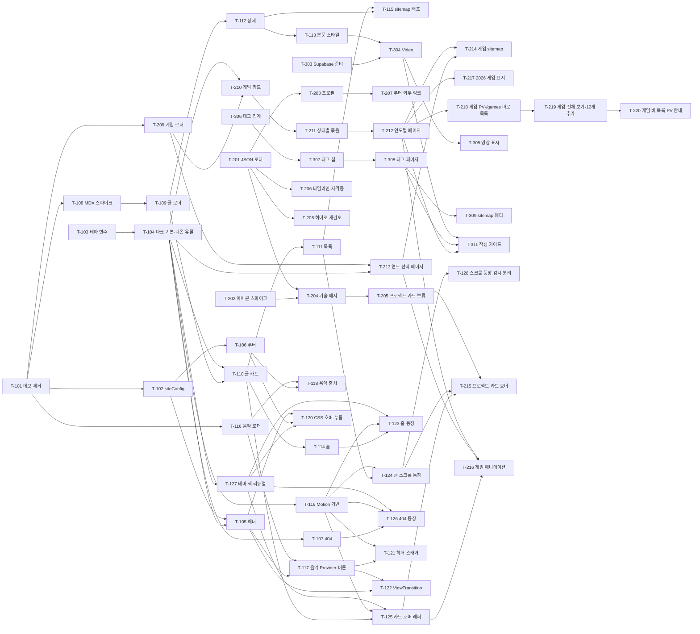

# 로드맵: 게임 개발자 개인 블로그

> 기준 PRD: .claude/docs/PRD.md · 작성일: 2026-11-08 · 갱신: 2026-11-09 (F015 배경 음악, F016 UI 애니메이션 반영 / F012 테마를 블랙 + 시안 1색으로 변경 — T-127 추가, 게임 데이터 실제 값 반영 / T-212 완료 조건 실제 구현 반영, 콘텐츠 최소 개수 제약 추가, T-310 게임 표지 포함, T-217 추가 / F017 게임 PV·F014 `/games` 구조 변경 — T-218 추가(완료)) · 갱신: 2026-11-12 (F014 전체·연도별 보기, `earlier.json` — T-219 추가(완료), 4장 다음 작업 정리 / T-219 리뷰 반영, T-218 시절 현재형 설명 정리 / F013 바 형태 목록·F017 PV 안내 문구, 유튜브 썸네일 미사용 — T-220 추가(완료), T-216 "게임 줄 호버"로 변경) · 갱신: 2026-11-12 (T-201 소개용 JSON 스키마·로더 완료, PRD 데이터 모델 검증 규칙 반영, T-204·T-205 완료 조건 조정, 4장·6장 정리) · 갱신: 2026-11-12 (T-120·T-121·T-123·T-124·T-126 애니메이션 묶음 A, T-122 페이지 전환(래퍼를 레이아웃 `<main>` 안 한 곳으로 변경), T-125 HoverCard 구조와 `accent-hover-in-group` 완료 → 단계 1 완료. 6장 미결 사항 정리, 2장 페이지 전환 설명을 구현에 맞춤) · 갱신: 2026-11-13 (소개 페이지를 없애고 홈에 통합 — 헤더 메뉴 3개, 실제 데이터, skills 분류 5개·timeline `certificate`, 기술 배지 브랜드 색 아이콘. T-203·T-204·T-206 완료, T-205 보류, T-207 축소, T-208·T-215 재정리, `app/loading.tsx` 제거 반영) · 갱신: 2026-11-13 (T-302 이전/다음 글 링크 완료) · 갱신: 2026-11-13 (T-306 태그 집계·한글 표시 이름 대응표 완료, `out/blog/tags/shader` 확인은 T-308로 이동, T-307 메모, 4장 갱신) · 갱신: 2026-11-13 (T-307 태그 칩 목록·링크 완료 — 카드 칩은 표시만, '전체 n' 칩, 강조는 포인트 색 + aria-current, `all` 예약어, T-308과 함께 커밋, 4장·6장 갱신) · 갱신: 2026-11-13 (T-308 태그별 글 목록 페이지 완료 — "전체 글" 버튼은 '전체 n' 칩으로 대체, sitemap은 T-309, 4장·5장·6장 갱신) · 갱신: 2026-11-13 (T-216 게임 페이지 스크롤 등장·게임 줄 호버 완료 — 6장 미결 2건 결정됨으로 이동, 4장 집계·다음 작업 갱신) · 갱신: 2026-11-14 (T-208 홈 히어로 재검토 완료 — 코드 변경 없이 문구 유지, 6장 미결 1건 결정됨으로 이동, 4장 집계·다음 작업 갱신) · 갱신: 2026-11-14 (T-309 sitemap 태그 페이지·페이지별 메타데이터·OG 완료, 4장 갱신) · 갱신: 2026-11-14 (F016 페이지 전환 크로스페이드 제거 — T-122 메모, 스크롤 등장 반복 재생 — T-124 메모, T-128 스크롤 등장 감시·애니메이션 요소 분리 추가, 1·2·4·5·6·7장 갱신) · 갱신: 2026-11-14 (T-128 스크롤 등장 감시·애니메이션 분리 완료, 4장 갱신) · 갱신: 2026-11-14 (T-310 basePath 대응 완료, 4·5·6장 갱신) · 갱신: 2026-11-14 (T-303 Supabase 준비 완료, 4·5·6장 갱신) · 갱신: 2026-11-14 (T-304 Video 컴포넌트 완료, 리뷰 반영(title 필수·자막 선택), 4장 갱신)

## 1. 개요

- 목표:
  1. 게임 개발자인 운영자를 소개하는 홈 섹션(프로필·기술 스택·경력·학력·자격증)을 만든다 (F001~F004, 별도 소개 페이지 없음 — 2026-11-13 홈으로 통합).
  2. 글·사진·영상으로 된 개발 기록을 MDX 파일로 쓰고 최신순·태그별로 보여 준다 (F006~F009, F011).
  3. 좋아하고 플레이 중인 게임을 연도별 JSON 기록으로 남기고 전체 보기(`/games`)와 연도별 페이지(`/games/<연도>`)로 보여 준다 (F013, F014).
  4. "블랙 + 차분한 시안 1색"의 모던한 테마를 전 페이지에 적용하고, 게임 개발 콘셉트는 문구(404 "GAME OVER" 등)로 살린다 (F010, F012 — 2026-11-09 시안·마젠타 네온에서 변경).
  5. 헤더 버튼으로 켜는 배경 음악과, 짧고 깔끔한 등장·호버 애니메이션으로(페이지 전환 효과는 2026-11-14 제거) 게임 같은 분위기를 완성한다 (F015, F016).
- 성공 지표 (제안):
  - 운영자가 MDX 파일 하나를 커밋·푸시하면 별도 코드 수정 없이 목록·상세·태그 페이지에 반영된다.
  - 운영자가 `content/games/<연도>.json` 하나를 추가하면 코드 수정 없이 보기 목록·연도 페이지가 늘어나고, 그해 게임이 `/games` 전체 보기에도 바로 합쳐져 보인다.
  - 모든 페이지가 데스크톱·모바일, 다크·라이트 모드에서 깨지지 않고, 포인트 색 텍스트가 WCAG AA 대비를 만족한다.
  - 운영자가 `content/music.json`과 `public/audio/bgm.mp3`를 넣기만 하면 코드 수정 없이 음악 버튼과 푸터 출처 문구가 나타난다.
  - "동작 줄이기" 설정에서 이동·기울기 애니메이션이 하나도 보이지 않고, 애니메이션 때문에 레이아웃이 흔들리지 않는다.
- 범위 밖: 영상 대본, 로그인·관리자 글쓰기 화면, 댓글·좋아요·구독(RSS), 전체 글 검색·다중 태그 필터·시리즈, 별도 소개 페이지(`/about`), 프로젝트 상세 페이지(프로젝트 카드 섹션은 데이터가 비어 보류), 문의 폼·이메일 공개, 다국어, 조회수 집계, 코드 블록 복사 버튼·줄 번호·파일 이름, 게임 기록의 상태·플랫폼 필터·게임별 상세 페이지·여러 해 통계·외부 게임 DB(API) 연동, 배경 음악 음량 조절·재생 목록·페이지별 음악·켜짐 상태 기억·재방문 자동 재생, 홈 히어로 타이핑·글리치·패럴랙스·커서 효과 (PRD "MVP 이후 기능")

## 2. 기술 방향

- 아키텍처 요약:
  - `output: "export"` 정적 사이트. 모든 콘텐츠는 저장소 파일이고 **빌드 시점**에 읽는다.
  - 글: `content/posts/<slug>.mdx` (YAML frontmatter: title, date, summary, tags, thumbnail). 사진은 `public/images/posts/<slug>/`.
  - 태그 (결정됨): frontmatter `tags`에는 **영문 slug**(소문자·숫자·하이픈, 예: `shader`)만 쓰고, 화면에 보일 한글 이름은 `content/tags.json`(slug → 표시 이름 대응표)에서 가져온다. 대응표에 없는 태그는 slug를 그대로 표시한다. 주소는 항상 `/blog/tags/<영문 slug>`.
  - "영상 포함" 표시 (결정됨): frontmatter 필드 없이, 로더가 빌드 시 본문에 `<Video` 컴포넌트가 있는지 검사해 `hasVideo`를 계산한다.
  - 소개 데이터: `content/profile.json`, `skills.json`, `projects.json`, `timeline.json`을 `lib/`의 로더가 zod로 검증한 뒤 **홈(`app/page.tsx`)**이 섹션 컴포넌트(프로필·기술 스택·경력·학력·자격증)에 넘긴다 (2026-11-13: 별도 `/about` 없음, 헤더 메뉴 3개). skills 분류는 language·engine·os·ide·etc 5개, timeline type은 work·education·certificate(자격증은 홈에서 별도 섹션). `projects.json`은 빈 배열이라 프로젝트 섹션은 화면에 없고, `profile.json`의 `links`는 데이터로만 있다(푸터 연동은 T-207). 기술 배지의 아이콘 경로·브랜드 색은 server-only `lib/tech-icon.ts`가 simple-icons에서 읽는다.
  - 게임 기록 (결정됨): `content/games/<연도>.json`(연도 = 파일 이름, 파일 하나 = 연도 페이지 하나), 표지는 `public/images/games/<연도>/`. `lib/games.ts`가 zod로 검증하고 잘못된 데이터는 빌드 실패. 2026 이전에만 플레이해 정확한 연도가 없는 게임은 `content/games/earlier.json`(표지 `public/images/games/earlier/`, 파일 없어도 됨)에 둔다. 헤더 "게임"(`/games`)은 **전체 보기**로, 모든 연도 파일 + `earlier.json`을 합치고 연도 파일끼리 같은 slug는 가장 최근 연도 것 하나만 보여 준다(2026-11-12 T-219에서 T-218의 "최신 연도 바로 목록"을 대체). `earlier.json`과 연도 파일에 같은 slug가 있으면 빌드 실패(연도 파일끼리 겹침은 해를 넘긴 게임이라 허용). 제목 아래 보기 목록은 '전체 · 2026 · …'이고, 연도별 페이지 `app/games/[year]`(`generateStaticParams` + `dynamicParams = false`, 없는 연도 404)는 그해 파일만 보여 준다. 두 페이지 내용이 달라 canonical은 두지 않고, sitemap에는 `/games`와 모든 `/games/<연도>`가 들어간다. 플랫폼은 한글 표기("PC (Steam)", "PC", "모바일"), 여러 개면 "PC, 모바일" 순서. 정적 내보내기라 리디렉션 없이 링크로만 이동한다. 게임 PV(F017)는 `trailer`(유튜브 영상 ID)를 카드 위 버튼 → Dialog 팝업의 youtube-nocookie iframe으로 재생하고, 팝업이 열렸을 때만 iframe을 그린다. 평점은 1~5 정수, 해를 넘긴 게임은 다음 해 파일에 다시 적는다.
  - 코드 블록 (F007): `rehype-pretty-code`가 붙여 주는 언어 정보(`data-language`)를 `mdx-components.tsx`에서 받아 전용 패널 상단에 표시 이름으로 보여 준다. 서버 컴포넌트로만 처리해 클라이언트 JS가 없다.
  - 동적 경로(`app/blog/[slug]`, `app/blog/tags/[tag]`)는 `generateStaticParams` + `export const dynamicParams = false`로 빌드 시 모두 만들고, 없는 경로는 404가 된다 (정적 내보내기는 `dynamicParams: true`를 지원하지 않음 — `static-exports.md` 확인).
  - 영상은 Supabase Storage 공개 버킷 URL을 `<video>`로 재생만 한다 (SDK·API 키 없음).
  - 이미지는 `next/image` 최적화 없이 내보낸다 (기본 loader는 정적 내보내기에서 불가).
  - basePath (T-310): 이미지·음원 경로와 메타데이터 주소의 basePath는 `lib/base-path.ts`(`withBasePath`, `siteUrl`, 서버 전용)로 처리한다.
  - 데이터 흐름: `content/*` → `lib/posts.ts`, `lib/content.ts` (서버 전용, fs 사용) → `app/*/page.tsx` → `components/sections/*`.
  - 배경 음악 (F015): `lib/music.ts`가 빌드 시 `content/music.json`(zod 검증)과 `public/audio/<file>` 존재를 확인해 둘 다 있을 때만 곡 정보를, 하나라도 없으면 `null`(음원 없음)을 돌려준다. `app/layout.tsx`가 이 값을 클라이언트 Provider(`components/providers/bgm-provider.tsx`)에 넘기고, Provider가 `<audio loop>` 하나를 **루트 레이아웃에 한 번만** 둔다. 레이아웃은 사이트 안 링크 이동 때 다시 그려지지 않으므로 음악이 이어지고, 새로고침·새 탭은 새 방문이라 항상 꺼짐에서 시작한다. 켜짐/꺼짐은 React 상태(메모리)에만 두고 localStorage·sessionStorage·쿠키에 저장하지 않는다. 추가 라이브러리 없음.
  - 애니메이션 (F016): 등장·스태거·스크롤 등장·카드 호버는 **Motion**(`motion/react`)의 `"use client"` 래퍼 컴포넌트(`components/shared/motion/`)로 만들고, 페이지·섹션은 서버 컴포넌트로 둔 채 래퍼로 감싸기만 한다. 루트에 `MotionConfig reducedMotion="user"`를 두어 "동작 줄이기" 시 transform(이동·기울기)을 끄고 투명도만 남긴다. 단순 색·밑줄·누름 효과는 Tailwind `transition`·`active:`·`motion-reduce:`로 처리한다 (JS 없음).
  - 페이지 전환 (F016): **2026-11-14 제거 — 전환 효과 없이 즉시 이동한다.** 배포 사이트에서 헤더 메뉴로 이동할 때 이전 화면이 약 0.36초 남아 보이고 모바일에서는 메뉴 시트가 열린 화면이 찍혀 보일 수 있어 사용자가 없애기로 했다. `components/shared/page-transition.tsx`를 삭제하고 레이아웃 `<main>`에 children을 직접 두며, `globals.css`의 `::view-transition` 규칙과 헤더·푸터의 `viewTransitionName`을 지웠다. 새 페이지의 등장 애니메이션(홈 히어로 등)은 그대로다. 원인은 예전 회색 스켈레톤(프리페치 파일 이름) 문제가 아니다(배포 사이트에 `__next.blog.__PAGE__.txt` 형식 파일이 정상으로 있음). 아래는 제거 전(T-122) 설명으로 기록용이다. — React `<ViewTransition>`(`import { ViewTransition } from 'react'`) 크로스페이드를 기본 방식으로 썼다. 가이드(`node_modules/next/dist/docs/01-app/02-guides/view-transitions.md`) 확인 결과 **App Router에서 설정 없이 동작**하고(실험 플래그 불필요, `next.config` 문서에 관련 옵션 없음), `<ViewTransition>`은 React 19.3에 포함된다 (프로젝트 React 19.3.1 — 메인 세션이 package.json으로 확인). Next.js 라우트 이동은 transition이라 자동으로 활성화된다. 레이아웃은 이동 때 유지되어 enter/exit가 발생하지 않으므로 `<ViewTransition update>`를 쓰는 공통 `PageTransition`을 **레이아웃 `<main>` 안 한 곳**에 두고(새 페이지는 따로 감싸지 않음, 2026-11-12 T-122 확정), 헤더·푸터는 래퍼 바깥이라 움직이지 않는다. `PageTransition`은 하이드레이션 전에는 `update="none"`, 그 뒤에는 `"page-fade"`로 켜서 첫 접속 때 본문이 늦게 보이지 않게 한다. 지원하지 않는 브라우저는 애니메이션 없이 즉시 전환된다. Motion의 퇴장(exit) 애니메이션은 쓰지 않는다. 별도 로딩 화면(`app/loading.tsx`)은 2026-11-13에 제거했다(Windows 로컬 빌드에서 Next 16 export가 세그먼트 프리페치 파일 이름을 역슬래시로 잘못 만들어 이동 때 회색 스켈레톤이 끼어 보였음, Linux CI 빌드는 정상). 이동은 크로스페이드 한 번만 보인다.
- MDX 방식 (Next.js 16 공식 가이드 `node_modules/next/dist/docs/01-app/02-guides/mdx.md` 확인함):
  - **1순위: `@next/mdx`** (+ `@mdx-js/loader`, `@mdx-js/react`, `@types/mdx`). 공식 가이드의 "Using dynamic imports" 패턴(`await import(\`@/content/posts/${slug}.mdx\`)` + `generateStaticParams` + `dynamicParams = false`)이 이 프로젝트 구조와 그대로 맞는다. 루트에 `mdx-components.tsx`가 **필수**다.
  - 주의 1: `@next/mdx`는 frontmatter를 기본 지원하지 않는다 → 목록용 메타데이터는 `gray-matter`로 원본 파일을 읽고, 렌더링 시 YAML이 본문에 찍히지 않게 `remark-frontmatter`를 쓴다 (또는 MDX 안의 `export const metadata` 방식으로 대체). T-108에서 결정.
  - 주의 2: Turbopack에서는 remark/rehype 플러그인을 **문자열 이름 + 직렬화 가능한 옵션**으로만 지정할 수 있다 (`rehype-pretty-code`의 테마 옵션이 문자열이면 가능할 것으로 보임 — T-301에서 확인).
  - 주의 3: `next.config.ts`에 이미 Turbopack CSS 규칙이 있으므로 `withMDX` 래핑 시 기존 설정이 유지되는지 확인한다.
  - 대안: `@next/mdx`가 막히면 next-mdx-remote(RSC) → Velite 순으로 검토 (React 19 호환 여부는 T-108에서 npm 정보로 확인).
- 추가 라이브러리:
  - `@next/mdx`, `@mdx-js/loader`, `@mdx-js/react`, `@types/mdx` — MDX 렌더링 — Next.js 공식 가이드 방식이라 버전 호환 위험이 가장 낮음
  - `gray-matter` — 목록용 frontmatter 읽기 — 공식 가이드가 언급하는 검증된 도구
  - `remark-frontmatter` (필요 시 `remark-gfm`) — frontmatter 숨김, 표·체크리스트 지원 — remark 공식 생태계
  - `rehype-pretty-code` + `shiki` — 코드 블록 하이라이트(빌드 시) — 클라이언트 JS 없이 다크/라이트 테마 지원
  - `@tailwindcss/typography` — MDX 본문 기본 서식(`prose`) — 공식 가이드 권장, Tailwind v4는 `globals.css`에 `@plugin`으로 등록 (문서 확인 필요)
  - `simple-icons` — 기술 브랜드 아이콘 (T-202 확정, 본체 사용) — 어두운 테마색 배지 + 브랜드 색 아이콘으로 표시(T-204, 2026-11-13에 T-202의 단색 결정 변경). 쓰는 아이콘 license는 모두 없음(출처 표기 불필요)
  - `motion` (구 Framer Motion, `motion/react`) — F016 등장·스태거·`whileInView`·`whileHover`·기울기 — PRD에서 사용자가 선택, React 19 지원, `MotionConfig reducedMotion="user"`로 동작 줄이기를 한 곳에서 처리. 래퍼는 `components/shared/motion/`, Provider는 `components/providers/` (T-119에서 peerDependencies 확인)
  - ~~(추가 패키지 없음) React `<ViewTransition>` — 페이지 전환 크로스페이드 — React 19.3 내장, 브라우저 View Transitions API 기반~~ (2026-11-14 제거, 사용하지 않음)
  - (추가 패키지 없음) HTML `<audio>` — 배경 음악 — 한 곡 반복·재생/정지만 필요해 라이브러리가 과함 (음량·재생 목록이 필요해지면 Howler.js 검토)
  - 기존 재사용: `zod`(콘텐츠 스키마 검증), `next-themes`(기본 다크), `lucide-react`(일반 아이콘, 음표·음소거 아이콘), shadcn `Card`/`Badge`/`Avatar`/`Button`/`Separator`
- 기술 검토 필요:
  - 로그인 없이 운영자만 글 작성 — 서버 인증·DB 없음 → MDX 파일을 커밋·푸시하면 GitHub Actions가 빌드·배포 (F011)
  - 영상 호스팅 — 저장소 용량·파일 크기 제한, Pages 대역폭 → Supabase Storage 공개 버킷 URL을 `<video>`로 재생 (F008, T-303 확인 완료)
  - 사진 자동 최적화 — 정적 내보내기에서 기본 이미지 최적화 불가 → 최적화 없이 내보내고 운영자가 WebP·가로 1600px 이하(게임 표지는 가로 600px 이하)로 줄여 저장
  - "게임" 메뉴의 전체·연도별 보기 — 정적 내보내기라 요청 시 서버에서 데이터를 합치거나 걸러 줄 수 없음 → 빌드 시 모든 연도 파일과 `earlier.json`을 읽어 `/games`(전체)와 `/games/<연도>`(그해만)를 각각 정적 페이지로 생성, canonical 불필요 (T-213 연도 선택 페이지 → T-218 최신 연도 바로 목록 → 2026-11-12 T-219 전체 보기로 변경)
  - 게임 PV 재생 — 영상 파일을 직접 호스팅하면 용량·저작권 부담 → 공식 PV를 youtube-nocookie iframe으로 팝업이 열렸을 때만 불러옴, "YouTube에서 보기" 링크 제공 (F017, T-218)
  - 코드 하이라이트 플러그인 — Turbopack은 함수형 옵션을 넘길 수 없음 → 문자열 플러그인 이름·직렬화 가능한 옵션만 사용, 안 되면 빌드를 webpack으로 돌리는 대신 MDX 방식 자체를 재검토 (T-301)
  - ~~한글 태그 URL~~ — (해결됨) 영문 slug만 URL에 쓰고 한글은 표시 이름으로만 사용하기로 결정 (T-306)
  - 들어오자마자 배경 음악 재생 — 브라우저 자동 재생 정책상 사용자 클릭 전 소리 재생이 막힘 → 헤더 버튼으로 방문자가 직접 켜고, 방문마다 꺼짐에서 시작 (F015, T-117)
  - 음원 유무에 따라 버튼 표시 — 런타임에 서버로 파일 존재를 물을 수 없음 → 빌드 시 `fs`로 `music.json`·mp3 존재를 확인해 정적 HTML에 반영 (F015, T-116). 파일을 넣은 뒤에는 다시 빌드·배포해야 나타남
  - 이전 페이지가 사라지는 전환 — App Router가 이전 페이지를 바로 없애 Motion exit가 불안정 → React `<ViewTransition>` 크로스페이드로 구현(T-122)했으나 2026-11-14 제거, 지금은 전환 효과 없이 즉시 이동 (F016)

## 3. 단계별 계획

### 단계 1: MVP — 블랙 + 시안 테마와 정리된 레이아웃 위에서 MDX 글을 목록·상세로 읽을 수 있게 배포
완료 기준: 스타터킷 데모가 사라지고, 다크 기본 블랙 + 시안 1색 테마(T-127)의 헤더·푸터·404가 동작하며, 샘플 글 2개가 `/blog` 목록과 `/blog/<slug>` 상세에서 보이고, 홈에 최근 글이 나오는 상태로 `npm run build`가 통과해 배포할 수 있다. 음원 파일이 없으면 음악 버튼·출처 문구가 숨겨지고(있으면 켜기/끄기와 페이지 이동 시 이어 재생이 동작), 헤더 스태거·글 카드 호버·스크롤 등장이 "동작 줄이기" 설정을 따른다. (페이지 전환은 2026-11-14 제거되어 이동이 즉시 바뀐다.)

#### 에픽 1.1 스타터킷 정리 (PRD: 메뉴 구조, F010)
- [x] **T-101** 스타터킷 데모 페이지·섹션 제거 · P0 · S · 의존: 없음
  - 완료 조건: `/components` 경로가 빌드 결과에서 사라져 404가 되고, 데모 전용 섹션을 import하는 곳이 없으며 `npm run lint`·`npx tsc --noEmit`·`npm run build`가 통과한다. 쓰지 않게 된 패키지(react-hook-form 등)는 지우지 않고 목록만 남긴다.
  - 위치: app/components/page.tsx, components/sections/component-showcase.tsx, components/sections/example-form.tsx, components/sections/features.tsx, components/sections/cta.tsx (기존 파일 확인 필요 — 재사용할 부분이 있으면 남김)
  - 계획: [plans/T-101.md](plans/T-101.md)
- [x] **T-102** 사이트 설정을 블로그용으로 변경 · P0 · S · 의존: T-101
  - 완료 조건: `siteConfig`의 이름·설명이 블로그 내용으로 바뀌고, `mainNav`가 홈·블로그·게임·소개 4개뿐이며 헤더·모바일 메뉴·sitemap에 같은 4개가 보인다 (`/blog`는 단계 1 T-111, `/games`는 단계 2 T-213에서 만들어짐. 그 전까지 링크 404 허용 — 배포 시 주의는 "5. 위험 요소" 참고).
  - 메모: "mainNav 4개" 중 '게임'은 T-115에서 임시로 숨겼고, T-213(`/games` 페이지)에서 다시 추가한다.
  - 메모 (2026-11-13): 소개 페이지를 홈으로 통합하면서 '소개'가 `mainNav`에서 빠져 헤더·모바일 메뉴·sitemap은 **홈·블로그·게임 3개**다 (`/about`은 404).
  - 위치: config/site.ts, app/layout.tsx(메타데이터, 기존 파일 확인 필요)
  - 계획: [plans/T-102.md](plans/T-102.md)

#### 에픽 1.2 게임 개발자 테마 (PRD: F012)
- [x] **T-103** 시안·마젠타 네온 테마 변수 정의 · P0 · M · 의존: 없음
  - 메모: 이 작업의 시안·마젠타 네온 값은 2026-11-09 PRD 변경(블랙 + 시안 1색)으로 T-127에서 다시 정리한다.
  - 완료 조건: `globals.css`에 다크·라이트 각각 주 포인트(시안)·보조 포인트(마젠타)와 글로우용 변수가 정의되고, 포인트 색 텍스트가 배경 대비 WCAG AA(4.5:1)를 만족함을 대비 측정 결과로 계획 문서에 기록한다. 라이트 모드는 채도·밝기를 낮춘 값을 쓴다.
  - 위치: app/globals.css
  - 계획: [plans/T-103.md](plans/T-103.md)
- [x] **T-104** 기본 다크 모드와 네온 효과 유틸리티 · P0 · S · 의존: T-103
  - 완료 조건: 저장된 값이 없는 첫 방문에서 다크 모드로 보이고, 토글로 바꾼 값이 새로고침 후에도 유지된다. 글로우·네온 테두리·호버 강조를 Tailwind 유틸리티(`@utility` 등)로 정의해 버튼·카드에 클래스 하나로 붙일 수 있다.
  - 위치: components/providers/theme-provider.tsx 또는 app/layout.tsx (기존 파일 확인 필요), app/globals.css
  - 계획: [plans/T-104.md](plans/T-104.md)

#### 에픽 1.3 공통 레이아웃 (PRD: F010)
- [x] **T-105** 헤더·모바일 메뉴 네온 스타일 적용 · P1 · S · 의존: T-102, T-104
  - 완료 조건: 현재 페이지 메뉴가 네온 색으로 강조되고(`/games/2026`처럼 하위 경로에서도 "게임"이 강조됨), 모바일(375px)에서 시트 메뉴가 열려 4개 메뉴와 테마 토글이 동작한다.
  - 위치: components/layout/site-header.tsx, main-nav.tsx, mobile-nav.tsx, components/shared/theme-toggle.tsx (기존 파일 확인 필요)
  - 계획: [plans/T-105.md](plans/T-105.md)
- [x] **T-106** 푸터 정리 · P1 · S · 의존: T-102
  - 완료 조건: 푸터에 블로그·게임·소개 링크와 외부 링크 자리가 보인다. 단계 1에서는 외부 링크를 `siteConfig`에 임시로 두고, T-207에서 `profile.json`의 `links`로 바꾼다. 이메일·전화번호는 없다.
  - 위치: components/layout/site-footer.tsx (기존 파일 확인 필요), config/site.ts
  - 메모 (2026-11-09): 푸터 메뉴 링크(블로그·게임·소개)는 2026-11-09에 제거했고, 푸터에는 외부 링크만 남긴다.
  - 계획: [plans/T-106.md](plans/T-106.md)
- [x] **T-107** "GAME OVER" 404 페이지 · P0 · S · 의존: T-104
  - 완료 조건: 없는 주소(`/no-such-page`)로 가면 GAME OVER 연출의 안내 문구와 "홈으로"·"블로그 보기" 버튼이 보이고, 각각 `/`·`/blog`로 이동한다. 빌드 결과에 `404.html`이 생긴다.
  - 위치: app/not-found.tsx (규칙: node_modules/next/dist/docs/01-app/03-api-reference/03-file-conventions/not-found.md)
  - 계획: [plans/T-107.md](plans/T-107.md)

#### 에픽 1.7 배경 음악 (PRD: F015) — T-107 다음에 진행 (작업 번호는 추가 순서라 T-116부터)
- [x] **T-116** 배경 음악 데이터 로더와 음원 유무 판정 · P0 · S · 의존: T-101
  - 완료 조건: `getBackgroundMusic()`가 빌드 시 `content/music.json`을 zod(file, title, artist, source, sourceUrl 선택, license)로 검증하고 `public/audio/<file>`이 실제로 있을 때만 곡 정보를 돌려준다. ① `music.json`이 없을 때 ② `music.json`은 있는데 mp3가 없을 때 둘 다 `null`을 돌려주고 빌드는 통과한다 (지금처럼 음원을 아직 넣지 않은 상태가 정상 동작). ③ `music.json`이 있는데 필드가 빠졌거나 `file`이 경로(`/`·`..` 포함)이거나 `.mp3`가 아니면 파일 이름이 들어간 메시지와 함께 빌드가 실패한다. 서버 전용(fs 사용)이며 클라이언트 번들에 들어가지 않는다.
  - 위치: lib/music.ts (content/music.json·public/audio/bgm.mp3는 사용자가 나중에 추가 — 이 작업에서는 만들지 않음)
  - 계획: [plans/T-116.md](plans/T-116.md)
- [x] **T-117** 배경 음악 Provider와 헤더 음악 버튼 · P0 · M · 의존: T-116, T-105
  - 완료 조건: ① 음원이 없으면(`null`) 데스크톱·모바일 헤더 어디에도 음악 버튼이 없고 빌드 결과 HTML에 `<audio>`도 없다. ② 임시로 `music.json`과 짧은 mp3를 넣고 확인했을 때(확인 후 커밋하지 않고 제거): 페이지를 열면 항상 꺼짐(음소거 아이콘)이고 소리가 나지 않으며, 버튼을 누르면 한 곡이 반복 재생되고 음표 아이콘 + 네온 글로우로 바뀌며, 다시 누르면 멈춘다. ③ 켠 상태로 헤더 메뉴·카드 등 `next/link`로 다른 페이지에 가도 음악이 끊기지 않는다. ④ 새로고침·새 탭에서는 다시 꺼짐에서 시작하고, localStorage·sessionStorage·쿠키에 아무 값도 저장하지 않는다 (개발자 도구로 확인). ⑤ 버튼에 `aria-label`("배경 음악 켜기"/"배경 음악 끄기")과 `aria-pressed`가 있어 키보드로도 켜고 끌 수 있다. ⑥ `audio.play()`가 거부되면 꺼짐 상태로 돌아가고 콘솔 오류가 남지 않는다. ⑦ `<audio>`는 `preload="none"`이라 켜기 전에는 음원을 내려받지 않는다.
  - 위치: components/providers/bgm-provider.tsx("use client", `<audio loop>`·상태 컨텍스트), components/shared/bgm-toggle.tsx(shadcn Button + lucide 음표·음소거 아이콘), components/layout/site-header.tsx, app/layout.tsx (기존 파일 확인 필요). Provider는 이후 페이지 전환 래퍼(T-122)보다 바깥(루트 레이아웃)에 둔다. 음원 경로의 basePath 처리는 T-310과 같은 방식.
  - 계획: [plans/T-117.md](plans/T-117.md)
- [x] **T-118** 푸터 배경 음악 출처·라이선스 문구 · P0 · S · 의존: T-116, T-106
  - 완료 조건: 음원이 없으면 푸터에 출처 문구가 전혀 보이지 않는다. 임시 `music.json`과 mp3로 확인하면 "배경 음악: <곡 제목> — <작곡가> (<출처>, <라이선스>)"가 보이고, `sourceUrl`이 있으면 출처가 새 탭 링크(`target="_blank" rel="noopener noreferrer"`)이며 없으면 일반 텍스트다. 모바일(375px)에서 줄이 넘쳐도 가로 스크롤이 생기지 않는다.
  - 위치: components/layout/site-footer.tsx, components/shared/music-credit.tsx
  - 계획: [plans/T-118.md](plans/T-118.md)

#### 에픽 1.4 MDX 콘텐츠 파이프라인 (PRD: F011, F007)
- [x] **T-108** MDX 방식 확정 (스파이크) · P0 · M · 의존: T-101
  - 완료 조건: ① 공식 가이드 방식(`@next/mdx` + `mdx-components.tsx` + 동적 import + `generateStaticParams` + `dynamicParams = false`)으로 샘플 글 1개가 `npm run build` 후 `out/blog/<slug>.html`(또는 폴더)로 생성된다. ② frontmatter 처리 방식(gray-matter + `remark-frontmatter` / `export const metadata`)을 하나로 정한다. ③ 설치한 패키지의 peerDependencies가 Next.js 16·React 19와 충돌 없음을 `npm install` 경고 없음으로 확인한다. ④ 막히면 next-mdx-remote(RSC) → Velite 순으로 같은 기준을 검사하고 결과를 계획 문서에 적는다.
  - 위치: next.config.ts, mdx-components.tsx(루트), content/posts/, package.json
  - 계획: [plans/T-108.md](plans/T-108.md)
- [x] **T-109** 글 데이터 로더와 샘플 글 · P0 · M · 의존: T-108
  - 완료 조건: `getAllPosts()`가 `content/posts/*.mdx`를 날짜 내림차순으로 돌려주고, `getPostBySlug()`가 한 글을 돌려준다. frontmatter를 zod로 검증해 필수 필드(title, date, summary, tags)가 빠지거나 `tags`에 영문 slug 형식(`^[a-z0-9]+(-[a-z0-9]+)*$`)이 아닌 값(예: `셰이더`, `Shader`)이 있으면 파일 이름이 들어간 메시지와 함께 빌드가 실패한다. 날짜가 다른 샘플 글 2개(이미지 1장 포함, 태그는 영문 slug)를 넣는다.
  - 위치: lib/posts.ts, content/posts/*.mdx, public/images/posts/<slug>/
  - 계획: [plans/T-109.md](plans/T-109.md)

#### 에픽 1.5 블로그 목록·상세 (PRD: F006, F007)
- [x] **T-110** 글 카드 컴포넌트 · P0 · S · 의존: T-104, T-109
  - 완료 조건: 카드에 썸네일(없으면 네온 그라데이션 자리 표시), 제목, 요약, 작성일(YYYY-MM-DD), 태그 칩이 보이고 카드 전체를 누르면 글 상세로 간다. 호버 시 네온 테두리가 켜진다. (태그 칩 링크는 T-307에서 연결 → 카드 칩은 표시만으로 결정(T-307), 링크는 글 상세 칩과 `/blog` 상단 칩)
  - 위치: components/shared/post-card.tsx (shadcn Card·Badge 재사용)
  - 계획: [plans/T-110.md](plans/T-110.md)
- [x] **T-111** 블로그 목록 페이지 · P0 · S · 의존: T-110
  - 완료 조건: `/blog`에서 샘플 글 2개가 최신순으로 보이고, 글 파일을 모두 빼고 개발 서버에서 보면 "아직 글이 없습니다" 안내가 보인다.
  - 위치: app/blog/page.tsx, components/sections/post-list.tsx, components/shared/page-header.tsx (기존 파일 확인 필요)
  - 계획: [plans/T-111.md](plans/T-111.md)
- [x] **T-112** 글 상세 페이지 · P0 · M · 의존: T-109
  - 완료 조건: `/blog/<slug>`에 제목·작성일·태그·대표 이미지·본문과 "목록으로" 버튼이 보이고, 브라우저 탭 제목이 글 제목이다(`generateMetadata`). 없는 slug는 404 페이지가 된다.
  - 위치: app/blog/[slug]/page.tsx, components/sections/post-header.tsx
  - 계획: [plans/T-112.md](plans/T-112.md)
- [x] **T-113** 본문 타이포그래피와 MDX 요소 스타일 · P0 · S · 의존: T-112
  - 완료 조건: 본문의 제목 단계·목록·인용·링크·이미지·인라인 코드가 다크·라이트 모두에서 읽기 좋게 보이고(링크는 시안 포인트), 본문 이미지가 화면 폭을 넘지 않는다.
  - 위치: app/globals.css(`@tailwindcss/typography` 등록), mdx-components.tsx
  - 계획: [plans/T-113.md](plans/T-113.md)

#### 에픽 1.6 홈 최소 버전과 첫 배포 (PRD: F005 일부)
- [x] **T-114** 홈 페이지를 블로그 홈으로 교체 · P0 · S · 의존: T-110
  - 완료 조건: `/`에 이름·한 줄 소개(단계 1은 `siteConfig` 임시 값)와 최근 글 최대 3개 카드, "전체 글 보기" 버튼이 보이고 버튼이 `/blog`로 이동한다.
  - 위치: app/page.tsx, components/sections/hero.tsx (기존 파일 확인 필요), components/sections/recent-posts.tsx
  - 계획: [plans/T-114.md](plans/T-114.md)
- [x] **T-115** sitemap에 글 경로 추가와 첫 배포 점검 (제안) · P1 · S · 의존: T-111, T-112
  - 완료 조건: `out/sitemap.xml`에 `/blog`와 각 글 URL이 들어 있고, `npm run build` 결과물로 `/test` 브라우저 확인을 통과한다. `/games` 페이지(T-213)가 아직 없으면 sitemap에서 `/games`를 임시로 빼거나 단계 1 배포를 미루기로 정하고 계획 문서에 적는다. 푸시는 사용자가 한다.
  - 위치: app/sitemap.ts (기존 파일 확인 필요)
  - 계획: [plans/T-115.md](plans/T-115.md)

#### 에픽 1.9 테마 색 리뉴얼 (PRD: F012, 2026-11-09 변경) — 에픽 1.8 애니메이션 앞에 진행 (에픽·작업 번호는 추가 순서라 1.9 / T-127)
- [x] **T-127** 테마 색 리뉴얼 (블랙 + 차분한 시안 1색) · P0 · M · 의존: T-104
  - 완료 조건: ① `globals.css` 다크(기본) 모드의 배경·카드·테두리·본문 글자·보조 글자·포인트 값이 PRD F012(약 #0A0A0B / #131316 / #26262B / #EDEDEF / #8B8B93 / #5CC8D8)와 같고, 다크 `primary`·`ring`이 이 포인트 시안을 쓴다. ② 마젠타 변수(`--neon-magenta`, `--neon-magenta-glow`)와 글자·테두리 글로우 유틸리티(`neon-glow`, `neon-glow-magenta`, `neon-text`, `neon-text-magenta`)가 코드에서 사라지고, 남는 것은 accent 계열 이름(예: `--accent-cyan`, `accent-hover`)으로 정리되어 `neon-` 이름을 검색하면 결과가 없다. ③ 카드·버튼 호버는 테두리가 포인트 색으로 바뀌고 아주 옅은 그림자가 생기는 정도이며, 글자 글로우는 없다. ④ 라이트 모드는 무채색 + 진한 시안 1색이고, 두 모드 모두 본문·보조 글자·포인트 색 텍스트가 배경 대비 WCAG AA(4.5:1)를 만족함을 대비 측정 결과로 계획 문서에 기록한다. ⑤ 기존 사용처(히어로 제목·소개 버튼, 글 카드 호버, 최근 글 링크 호버, 404 GAME OVER, 헤더 현재 메뉴 강조, 음악 버튼 켜짐 표시)가 새 클래스로 바뀌고, 홈·블로그·글 상세·소개·404가 다크·라이트 모두에서 깨지지 않는다(`/test`).
  - 위치: app/globals.css, components/sections/hero.tsx, components/shared/post-card.tsx, components/sections/recent-posts.tsx, app/not-found.tsx, components/layout/main-nav.tsx·mobile-nav.tsx, components/shared/bgm-toggle.tsx (기존 파일 확인 필요 — 사용처는 메인 세션이 확인한 목록 기준이며 `neon-` 검색으로 빠진 곳을 찾음)
  - 계획: [plans/T-127.md](plans/T-127.md)

#### 에픽 1.8 모던 UI 애니메이션 기반과 적용 (PRD: F016)
- [x] **T-119** Motion 설치, 공통 애니메이션 래퍼, 동작 줄이기 기반 · P1 · M · 의존: T-104
  - 완료 조건: ① `motion`을 설치하고 `npm install`에서 React 19.3·Next.js 16과 peerDependencies 경고가 없다. ② 루트에 `MotionConfig reducedMotion="user"` Provider가 있고, 공통 래퍼 `FadeIn`(등장), `Stagger`/`StaggerItem`(차례 등장), `Reveal`(`whileInView`, `viewport={{ once: true }}` — 2026-11-14 `once: false`로 변경, T-124 메모)이 `motion/react`에서 import되며 이 파일들에만 `"use client"`가 붙는다 (페이지·섹션은 서버 컴포넌트 유지). ③ 지속 시간·이동 거리·이징을 한 곳(`lib/motion.ts`)에 상수로 두고 0.2~0.5초, 이동은 transform·opacity만 쓴다. ④ Playwright에서 `prefers-reduced-motion: reduce`를 에뮬레이션하면 래퍼가 이동 없이 투명도만 바뀐다. ⑤ `out/index.html`에 래퍼로 감싼 텍스트가 그대로 들어 있다(검색 엔진·JS 지연 대비).
  - 위치: package.json, components/providers/motion-provider.tsx, components/shared/motion/fade-in.tsx, stagger.tsx, reveal.tsx, lib/motion.ts, app/layout.tsx
  - 계획: [plans/T-119.md](plans/T-119.md)
- [x] **T-120** 링크·메뉴·버튼 호버/누름 마이크로 인터랙션 (CSS) · P1 · S · 의존: T-105, T-106, T-127 · 완료(2026-11-12)
  - 구현 메모: link-hover(@utility, 색·밑줄·배경 전환 150ms)를 헤더·모바일·푸터·최근 글 링크에 적용. 버튼은 누를 때 scale 0.97(동작 줄이기에서 1). press 유틸리티(scale 속성)는 이후 태그 칩 등용. 보기 목록(연도 탭)은 테두리 표시가 있어 link-hover 미적용, 음악 출처는 늘 밑줄 유지.
  - 완료 조건: 헤더·푸터 링크와 메뉴는 호버·키보드 포커스(`focus-visible`) 시 같은 색·밑줄 전환이 보이고, 버튼은 누를 때 살짝 작아진다(`active:scale-*`). 모두 Tailwind `transition`과 `motion-reduce:`로 처리해 JS를 추가하지 않고, 동작 줄이기에서는 크기 변화가 없다. 공통 클래스(`@utility` 등)로 만들어 이후 태그 칩(T-307)·연도 탭(T-212)·이전/다음 링크(T-302)가 그대로 재사용한다. 레이아웃이 밀리지 않는다.
  - 위치: app/globals.css, components/layout/main-nav.tsx, mobile-nav.tsx, site-footer.tsx (components/ui/button.tsx는 직접 수정 최소화 — 기존 파일 확인 필요)
  - 계획: [plans/T-120.md](plans/T-120.md)
- [x] **T-121** 헤더 첫 진입 스태거 등장 · P1 · S · 의존: T-119, T-117 · 완료(2026-11-12)
  - 구현 메모: 차례 등장 간격 0.05초(약 0.65초), 메뉴 항목은 motion.li. 화면에 안 보이는 항목(데스크톱의 모바일 버튼 등)도 순서를 차지해 간격이 조금 어색하나 사용자 결정으로 그대로 둠.
  - 완료 조건: 첫 접속·새로고침 때 로고 → 메뉴 항목(왼쪽부터) → 음악·테마 버튼이 짧은 간격으로 투명도·위치 전환으로 나타나고 전체가 약 0.6초 안에 끝난다. 사이트 안 링크 이동 때는 다시 재생되지 않는다(헤더는 레이아웃에 유지). 모바일 헤더도 같은 순서이며, 음원이 없어 음악 버튼이 숨겨진 경우에도 순서가 깨지지 않는다. 동작 줄이기에서는 투명도만 바뀐다.
  - 위치: components/layout/site-header.tsx, main-nav.tsx (T-119의 Stagger 재사용)
  - 계획: [plans/T-120.md](plans/T-120.md)
- [x] **T-122** 페이지 전환 크로스페이드 (React `<ViewTransition>`) · P1 · M · 의존: T-117, T-105 · 완료(2026-11-12)
  - 완료 조건: ① `import { ViewTransition } from 'react'`로 구현하고 **실험 플래그·`next.config` 변경 없이** 동작한다 (가이드 "View transitions work in the App Router with no configuration. React 19.3 includes the `<ViewTransition>` component" 확인함, React 19.3.1). `@types/react`에 `ViewTransition` 타입이 없어 `npx tsc --noEmit`가 실패하면 타입 패키지 버전을 확인해 계획 문서에 적는다(문서 확인 필요). ② 헤더 메뉴·카드 링크로 이동하면 이전 페이지 본문이 흐려지고 새 본문이 나타난다 (퇴장 약 150ms, 등장 약 210ms). ③ 헤더·푸터는 `<main>` 래퍼 바깥에 있어 전환 때 움직이지 않는다 (필요하면 `viewTransitionName`으로 고정). ④ `::view-transition { pointer-events: none; }`으로 전환 중 클릭이 사라지지 않는다. ⑤ `@media (prefers-reduced-motion: reduce)`에서 전환 애니메이션 시간이 0이다(즉시 전환). ⑥ 음악을 켠 채 이동해도 끊기지 않는다(Provider는 래퍼 바깥). ⑦ 미지원 브라우저에서도 이동은 정상이다. ⑧ 래퍼 위치: 공통 `PageTransition`(`components/shared/page-transition.tsx`, update 크로스페이드)을 페이지마다가 아니라 **레이아웃 `<main>` 안 한 곳**에 둔다. 새 페이지는 따로 감쌀 필요가 없다. Motion의 페이지 등장 애니메이션과 겹치지 않게 본문 전체에는 Motion을 쓰지 않는다.
  - 위치: components/shared/page-transition.tsx, app/layout.tsx, app/globals.css, components/layout/site-header.tsx, site-footer.tsx (규칙: node_modules/next/dist/docs/01-app/02-guides/view-transitions.md)
  - 계획: [plans/T-122.md](plans/T-122.md)
  - 메모 (2026-11-14 제거, 사용자 결정): 배포 사이트에서 헤더 메뉴 이동 때 이전 화면이 약 0.36초 남아 보이고 모바일에서는 메뉴 시트가 열린 화면이 찍혀 보일 수 있어 크로스페이드를 없앴다. `components/shared/page-transition.tsx` 삭제, 레이아웃 `<main>`에 children 직접, `globals.css`의 `::view-transition` 규칙 삭제, 헤더·푸터 `viewTransitionName` 제거. 이동은 즉시 바뀌고 새 페이지의 등장 애니메이션은 그대로. 원인은 예전 회색 스켈레톤(프리페치 파일 이름) 문제가 아님(배포 사이트에 `__next.blog.__PAGE__.txt` 형식 파일 정상). 작업은 완료 상태로 두고 아래 조건·메모는 기록용.
  - 구현 메모: 래퍼는 레이아웃 `<main>` 안 한 곳(update 크로스페이드)으로 확정. 헤더 메뉴, `/blog`→글, `/games`→`/games/2026` 전환 확인. `PageTransition`은 클라이언트 컴포넌트로, 하이드레이션 전에는 `update="none"`, 그 뒤에는 `"page-fade"`(`useSyncExternalStore`) — 서버 HTML에 전환 속성이 있으면 첫 접속 때 초기 화면 → 본문 교체에도 전환이 걸려 글꼴·이미지를 기다리느라 본문이 늦게 보이기 때문. (2026-11-13: 당시 있던 `app/loading.tsx`는 Windows 빌드의 프리페치 파일 이름 문제로 제거됨 — "5. 위험 요소" 참고. 지금은 로딩 화면 없이 크로스페이드 한 번만 보임.) 투명도만 바꿈(blur 없음): 퇴장 150ms, 등장 210ms, 본문 상자 크기 변화 애니메이션은 끔. 주의: 하이드레이션 뒤 `<main>` 안에서 `startTransition`으로 DOM을 바꾸면 본문 전체에 전환이 재생되므로, 나중에 본문 안 상태 변경에 transition을 쓰면 확인이 필요.
- [x] **T-123** 홈 등장 연출 · P1 · S · 의존: T-119, T-114, T-127 · 완료(2026-11-12)
  - 구현 메모: 히어로 delay 0.25초, 최근 글 delay 0.5초, 이동 거리 전체 8px.
  - 완료 조건: 홈이 그려질 때 히어로의 이름 → 한 줄 소개 → 버튼, 이어서 최근 글 카드가 차례로 나타난다. 첫 진입에서는 헤더 스태거 뒤에 이어서 재생되고, 사이트 안에서 홈으로 돌아올 때도 짧게 재생된다 (PRD 가정). 히어로는 이동 거리를 작게(약 8px 이하) 해서 JS가 늦어도 빈 화면이 오래 보이지 않는다. T-208에서 히어로 데이터가 바뀌어도 래퍼 구조는 유지된다.
  - 위치: components/sections/hero.tsx, components/sections/recent-posts.tsx
  - 계획: [plans/T-120.md](plans/T-120.md)
- [x] **T-124** 글 카드 목록 스크롤 등장 · P1 · S · 의존: T-119, T-111 · 완료(2026-11-12)
  - 구현 메모: 카드마다 Reveal(as=li)로 화면에 들어올 때 한 번, 같은 줄은 왼쪽부터 0.06초씩. 목록이 길어도 카드가 안 나타나는 문제 방지(리뷰 반영).
  - 완료 조건: `/blog`에서 아래로 스크롤하면 글 카드가 화면에 들어올 때 아래에서 살짝 올라오며 차례로 나타나고, 다시 스크롤해도 한 번만 재생된다 (2026-11-14 변경: 사용자 요청으로 화면에 들어올 때마다 다시 재생하고 화면 밖으로 나가면 다시 숨김 — Reveal·Stagger(inView)의 `viewport` `once: true` → `false`. 짧은 항목 깜빡임 대응은 T-128). 같은 목록 섹션을 쓰는 태그별 글 목록(T-308)에도 그대로 적용된다. 글 상세 본문 문단·코드 블록·영상에는 적용하지 않는다(PRD).
  - 위치: components/sections/post-list.tsx (T-119의 Reveal·Stagger 재사용)
  - 계획: [plans/T-120.md](plans/T-120.md)
- [x] **T-125** 카드 호버 떠오름·기울기 공통 래퍼와 글 카드 적용 · P1 · M · 의존: T-119, T-110, T-127 · 완료(2026-11-12)
  - 완료 조건: 공통 `HoverCard` 래퍼로 글 카드에 마우스를 올리면 살짝 떠오르고 마우스 위치를 따라 수 도(약 4° 이하) 기울며 T-127의 포인트 색 테두리(+ 옅은 그림자)가 함께 켜진다. 터치 기기(`hover: none`)에서는 기울기 없이 누름 효과만, 동작 줄이기에서는 떠오름·기울기 없이 포인트 색 테두리만 보인다. 키보드 포커스에도 포인트 색 테두리가 보이고, 카드 전체 링크 클릭이 그대로 동작하며 주변 카드가 밀리지 않는다. 이후 프로젝트 카드(T-215)·게임 줄(PV 버튼, T-216)이 같은 래퍼를 쓴다.
  - 위치: components/shared/motion/hover-card.tsx, components/shared/post-card.tsx, lib/motion.ts, app/globals.css(accent-hover-in-group)
  - 계획: [plans/T-125.md](plans/T-125.md)
  - 구현 메모: 값은 떠오름 4px, 기울기 최대 3°, 누름 0.98배, spring stiffness 300·damping 25, 원근 800px(`HOVER_PERSPECTIVE`). 구조는 링크(제자리, `.group`) > HoverCard 바깥 div(제자리, 호버·누름·마우스 위치를 받음, 호버 중 z-10) > 안쪽 motion.div(움직임, 테두리). 움직이는 요소가 직접 호버를 받으면 가장자리에서 떨리고, 링크까지 떠오르면 아래 4px에서 테두리가 꺼지고 클릭이 안 되기 때문. 테두리 강조는 새 유틸리티 `accent-hover-in-group`(바깥 `.group`의 hover·focus-visible 때 켜짐).
  - 구현 메모: 동작 줄이기에서는 `whileHover`·`whileTap`을 직접 끔(`MotionConfig reducedMotion="user"`는 transform을 없애지 않고 즉시 적용하므로). 호버 중 동작 줄이기가 켜지면 기울기를 0으로 되돌림. 감싼 div에 `tabIndex=-1`(Motion tap 이벤트가 div에 tabindex="0"을 붙여 Tab이 두 번 멈추고 하이드레이션 불일치가 생기므로). 누름은 CSS `:active`가 터치에서 불안정해 Motion으로 처리하고, 떠오름·누름은 variant 라벨 전파 대신 상태(onHoverStart/End, onTapStart/onTap/onTapCancel)를 안쪽 animate로 넘김(라벨 전파로는 호버 중 마우스 누름이 전달되지 않음).
- [x] **T-126** 404 안내 문구 등장 연출 · P2 · S · 의존: T-119, T-107, T-127 · 완료(2026-11-12)
  - 구현 메모: 404 라벨 → GAME OVER → 문구 → 버튼 차례 등장.
  - 완료 조건: `/no-such-page`에서 GAME OVER 안내 문구와 버튼이 투명도·위치 전환으로 차례로 나타나고, 버튼에 T-120의 호버·누름 효과가 있다. 동작 줄이기에서는 투명도만 바뀐다.
  - 위치: app/not-found.tsx (T-119의 Stagger 재사용)
- [x] **T-128** 스크롤 등장 감시·애니메이션 요소 분리 · P1 · S · 의존: T-124 · 완료(2026-11-14)
  - 배경 (2026-11-14, 코드 리뷰 지적·미확인 가능성): 스크롤 등장이 반복 재생(`once: false`)으로 바뀐 뒤, 감시하는 요소와 움직이는 요소가 같아(`lib/motion.ts`의 `fadeUp.hidden` y: 8) 높이 40px 안팎의 짧은 항목(게임 줄·자격증 등)이 화면 위쪽 가장자리에 걸치면 숨김(8px 내려감) ↔ 표시가 반복되며 깜빡일 수 있다.
  - 완료 조건: Reveal·Stagger(inView)가 transform 없는 바깥 요소에서 `useInView({ amount: 0.2 })`로 감시하고, 안쪽 motion 요소에 `animate`로 표시/숨김을 넘긴다. 짧은 항목을 화면 위 가장자리에 걸쳐 멈춰도 깜빡이지 않고, 아래에서 들어올 때마다 재생된다. 동작 줄이기·JS 꺼짐(`data-motion` noscript)·HoverCard·카드 클릭 동작은 그대로이고, ul/li 의미 구조(`as="li"`)를 깨지 않는다.
  - 위치: components/shared/motion/reveal.tsx, stagger.tsx (`useInView`는 `motion/react` — 기존 파일 확인 필요)
  - 계획: [plans/T-120.md](plans/T-120.md)
  - 계획: [plans/T-128.md](plans/T-128.md)
  - 완료 메모 (2026-11-14): Reveal은 바깥 일반 요소(`as` div|li, transform 없음)를 `useInView({ amount: 0.2 })`로 감시하고 안쪽 `motion.div`(`data-motion`)만 움직인다. `className`은 안쪽에 붙고 기본 `h-full`(그리드 카드 높이 맞춤). 기술 스택(skill-stack)은 `dl > div > dt/dd` 구조라 Stagger inView(바깥은 움직이지 않음, gap 0) + StaggerItem `as` dt/dd로 교체(StaggerItem `as`에 dt·dd 추가). 실기기 깜빡임 확인은 Playwright MCP가 끊겨 있어 사용자 모바일 확인으로 남김.

### 단계 2: 소개(홈 통합)·플레이 게임 페이지와 홈 완성 — 운영자가 누구이고 무엇을 만들고 즐기는지 보여 주기
완료 기준: 홈(`/`)에 히어로 → 프로필 → 기술 스택 → 경력·학력 → 자격증 → 최근 글이 JSON 데이터로 보이고(별도 `/about`은 없음, 프로젝트 섹션은 데이터가 비어 보류), 푸터 외부 링크가 `profile.json`의 `links`를 쓴다. `/games`에서 지금까지 플레이한 모든 게임(전체 보기)을, `/games/<연도>`에서 그해 게임을 상태별 카드로 볼 수 있고 카드에서 공식 PV를 팝업으로 재생할 수 있으며, 게임 데이터가 잘못되면 빌드가 실패한다.

#### 에픽 2.1 소개 데이터와 아이콘 (PRD: F011, F002)
- [x] **T-201** 소개용 JSON 스키마와 로더 · P0 · M · 의존: 단계 1 완료 · 완료(2026-11-12)
  - 구현 메모: `lib/content.ts`의 `getProfile`/`getSkills`/`getProjects`/`getTimeline`(서버 전용). 예시 데이터는 "(예시)" 자리표시 값이고 실제 값은 운영자가 JSON만 고치면 됨. 예시 skills에서 Git 아이콘은 CC-BY-3.0이라 빼고 GitHub로 대체. 검증: 모르는 필드·skills name 중복·projects slug 중복·한 프로젝트 stack 안 중복·stack의 미등록 기술·http/https 아닌 링크·없는 simple-icons slug·없는 사진/썸네일 파일은 빌드 실패. `SKILL_CATEGORIES`·`TIMELINE_TYPES`는 server-only 파일에 있으므로 클라이언트에서 값이 필요하면 별도 파일로 분리.
  - 완료 조건: `profile.json`, `skills.json`, `projects.json`, `timeline.json`을 zod로 검증하는 로더가 있고, `links`에 `mailto:`·`tel:`이 있거나 `projects[].stack`에 `skills.json`에 없는 이름이 있으면 빌드가 실패한다. 각 파일에 예시 데이터가 들어간다.
  - 위치: lib/content.ts, content/profile.json, content/skills.json, content/projects.json, content/timeline.json
  - 계획: [plans/T-201.md](plans/T-201.md)
- [x] **T-202** 기술 브랜드 아이콘 라이브러리 확정 (스파이크) · P0 · S · 의존: 없음
  - 완료 조건: `simple-icons`와 `react-icons/si` 중 하나를 고르고, Unity·Unreal Engine·Godot·C#·C++·Blender·GitHub·YouTube 아이콘이 실제로 있는지, 없는 것(상표 문제로 빠진 로고 등)은 어떻게 대신할지(Lucide 일반 아이콘 또는 텍스트 이니셜)를 표로 기록한다. 라이선스(아이콘 데이터 CC0, 브랜드 상표 지침)와 Lucide 브랜드 아이콘 지원 현황도 함께 적는다.
  - 위치: 계획 문서(plans/T-202.md), package.json
  - 계획: [plans/T-202.md](plans/T-202.md)
  - 메모 (2026-11-13): 이 작업의 "단색 `currentColor`로 그려 테마를 따른다" 결정은 T-204에서 "테마색 배지 + 브랜드 색 아이콘"으로 바뀜 (상대 휘도로 묻히는 색만 글자색 대체). 아이콘 없는 기술은 C#·Windows·VSCode·Visual Studio.

#### 에픽 2.2 홈의 소개 섹션 (PRD: F001, F002, F003, F004) — 2026-11-13에 별도 소개 페이지(`/about`)를 없애고 홈으로 통합
- [x] **T-203** 프로필 섹션 · P0 · S · 의존: T-201 · 완료(2026-11-13)
  - 완료 조건: **홈**의 프로필 섹션에 사진(없으면 이름 첫 글자 이니셜 아바타, 사진은 세로 3:4 각진 네모), 이름(`h2`, 페이지 `h1`은 히어로), 한 줄 소개, 관심 분야, 지금 공부 중인 것 목록이 보이고, `photo`를 비우면 이니셜 아바타로 바뀐다. 배열이 비면 그 줄은 숨겨진다.
  - 위치: components/sections/profile-intro.tsx (shadcn Avatar 재사용), app/page.tsx (처음엔 `/about`에 만들었으나 T-204에서 홈으로 이동, `app/about/`은 삭제)
  - 메모 (2026-11-13): 소개 데이터를 실제 값으로 교체 — 이름 김한승(사용자가 실명 공개 결정), 사진 `public/images/profile/profile.webp`(300×400), 공부 중 Claude AI 활용·Gameplay Ability System.
  - 계획: [plans/T-203.md](plans/T-203.md)
- [x] **T-204** 기술 스택 배지 · P0 · S · 의존: T-201, T-202 · 완료(2026-11-13)
  - 완료 조건: 홈의 기술 스택 섹션에 언어 / 게임 엔진 / 운영체제 / IDE / 기타 5개 묶음(빈 묶음은 숨김) 제목 아래 어두운 테마색 배지에 브랜드 색 아이콘과 이름이 보이고, 브랜드 색의 상대 휘도가 0.05 미만이면 다크 모드에서, 0.4 초과이면 라이트 모드에서 아이콘이 글자색으로 보인다(Unreal·Rider·GitHub / Unity·C). `icon`을 비운 기술(C#·Windows·VSCode·Visual Studio)은 이름 첫 글자 칸으로 깨지지 않게 표시된다. 사용한 아이콘의 simple-icons `license`가 모두 없어 출처 표기는 필요 없다. 아이콘은 `aria-hidden`이다.
  - 위치: components/shared/tech-badge.tsx, components/sections/skill-stack.tsx, lib/tech-icon.ts(server-only, simple-icons slug → path·hex·색 처리), lib/content.ts(`SKILL_CATEGORIES` = language·engine·os·ide·etc), content/skills.json(14개), app/page.tsx
  - 계획: [plans/T-204.md](plans/T-204.md)
- [ ] **T-205** 대표 프로젝트 카드 (보류 — 사용자 확인 필요) · P2 · S · 의존: T-204
  - 메모 (2026-11-14, T-310 리뷰): 프로젝트 thumbnail을 그릴 때 `withBasePath` 적용.
  - 메모 (2026-11-13): `projects.json`이 빈 배열(`[]`)이라 프로젝트 섹션은 화면에 없다. 데이터가 생길 때까지 보류하거나 범위 밖으로 확정할지는 "6. 미결 사항"에서 사용자 확인. 구현한다면 빈 목록이면 섹션째 숨김이 전제다.
  - 완료 조건: (보류 해제 시) 프로젝트마다 썸네일(없으면 자리표시)·제목·요약·사용 기술 배지(T-204 `TechBadge` 재사용)·외부 링크가 홈의 새 섹션으로 보이고, `link`가 없으면 링크 버튼이 숨겨지며, 링크는 `target="_blank" rel="noopener noreferrer"`로 새 탭에서 열린다. `projects.json`이 빈 배열이면 섹션 전체가 보이지 않는다. 모바일 1열, 데스크톱 2~3열이다.
  - 위치: components/sections/project-list.tsx, app/page.tsx
- [x] **T-206** 경력·학력 세로 타임라인 (+ 자격증 섹션 분리) · P0 · M · 의존: T-201 · 완료(2026-11-13)
  - 완료 조건: 홈의 경력·학력 섹션에 기간·직함·소속·설명이 세로 타임라인으로 보이고(`timeline.json` 파일 순서대로) 경력(work)·교육(education)이 아이콘(가방·학사모)과 라벨로 구분된다. `type: "certificate"` 항목은 이 타임라인에 나오지 않고 별도 **자격증** 섹션에 보인다(`timeline.json`의 type은 work·education·certificate). 모바일에서 글자가 겹치지 않는다.
  - 위치: components/sections/career-timeline.tsx, components/sections/certificate-list.tsx, lib/content.ts(`TIMELINE_TYPES`에 `certificate` 추가), content/timeline.json(경력 1·교육 2·자격증 1), app/page.tsx
  - 계획: [plans/T-204.md](plans/T-204.md)
- [x] **T-207** 푸터 외부 링크를 `profile.json` `links`로 옮기기 (solved.ac 포함) · P0 · S · 의존: T-203 (축소: 2026-11-13에 소개 페이지가 없어져 조립·외부 링크 버튼·"블로그 보기" 버튼은 범위에서 뺌)
  - 완료 조건: 푸터의 외부 링크가 `siteConfig`의 임시 값이 아니라 `profile.json`의 `links`에서 나오고(GitHub·solved.ac 포함, 새 탭 `target="_blank" rel="noopener noreferrer"`), T-106의 임시 값이 코드에서 사라진다. `icon`이 없는 링크(solved.ac는 simple-icons에 없음)도 깨지지 않고 텍스트로 표시된다. 이메일·전화번호는 없다. 홈에는 외부 링크 버튼을 두지 않는다.
  - 위치: components/layout/site-footer.tsx, app/layout.tsx(`getProfile()`로 읽어 푸터에 전달, 기존 파일 확인 필요), config/site.ts
  - 메모: 푸터 메뉴 링크는 2026-11-09에 제거했으므로 푸터에는 외부 링크만 있다.
  - 완료 메모 (2026-11-13): 푸터 외부 링크가 `profile.json` `links`에서 나오며 글자 링크만 표시(아이콘 없음), `config/site.ts`의 임시 `links` 삭제. `getProfile()`이 links url 중복이면 빌드 실패. 위치: app/layout.tsx, components/layout/site-footer.tsx, config/site.ts, lib/content.ts
  - 계획: [plans/T-207.md](plans/T-207.md)

#### 에픽 2.3 홈 완성 (PRD: F005)
- [x] **T-208** 홈 히어로 내용 재검토 · P2 · S · 의존: T-201 · 완료(2026-11-14)
  - 메모 (2026-11-13): 프로필(이름·소개·공부 중)은 히어로 아래 프로필 섹션(T-203)이 담당하므로 히어로는 사이트 이름 'HanS Dev Log'와 설명, "전체 글 보기" 버튼만 가진다(소개 버튼은 제거됨). 이미 이 상태라면 추가 작업이 없어 확인만 하고 완료 처리한다. 네온 글로우 강조는 T-127에서 시안 1색 강조로 바뀌어 대상이 아니다.
  - 완료 조건: 홈 히어로가 사이트 이름·설명(`siteConfig` 또는 정할 값)과 "전체 글 보기"(`/blog`) 버튼만 보여 주고(프로필과 내용이 겹치지 않음), 히어로 문구를 바꿀 필요가 없다고 사용자가 확인하면 완료. 바꾸기로 하면 문구·데이터 출처(`siteConfig` 유지 또는 `profile.json`)를 정한다.
  - 위치: components/sections/hero.tsx, app/page.tsx
  - 계획: [plans/T-208.md](plans/T-208.md)

#### 에픽 2.4 플레이 게임 기록 (PRD: F013, F014, F017, F011)
- [x] **T-209** 게임 기록 스키마·로더 (기존 2026.json 검증) · P0 · M · 의존: T-101
  - 완료 조건: `getGameYears()`가 `content/games/*.json` 파일 이름에서 연도 목록을 최신순으로 돌려주고, `getGamesByYear(year)`가 그해 게임을 돌려준다. 스키마는 이미 저장된 실제 데이터(`content/games/2026.json`, 10개 게임 — 사용자 결정) 기준이다: 필수는 slug·title·platforms, `status`는 **선택**(cleared/playing만 쓰고 없으면 상태 표시 없음), 날짜 필드는 `clearedAt` 대신 **`endedAt`**(클리어하지 않은 게임도 끝낸 날짜를 가질 수 있음), `startedAt`·`endedAt`은 선택이라 Slay the Spire 2처럼 날짜가 없는 게임도 통과, `rating`·`comment`는 비어 있어도 통과. zod로 검증해 다음 경우 **파일 이름이 들어간 메시지와 함께 빌드가 실패**한다: 필수 필드 누락, `status`가 있는데 허용 값(cleared/playing — PRD의 dropped/wishlist 허용 여부는 계획 단계에서 확정) 외의 값, `rating`이 있는데 1~5 정수가 아님(예: 0, 6, 4.5, "5"), 날짜가 YYYY-MM-DD가 아님, 같은 파일 안 slug 중복, 파일 이름이 네 자리 연도가 아님. 샘플 데이터를 새로 넣지 않고, 기존 `2026.json` 10개가 수정 없이 검증을 통과해 모두 로드됨을 확인한다 (잘못된 값은 임시로 넣어 실패 메시지만 확인하고 되돌림). 추가 라이브러리 없이 기존 `zod`를 쓴다.
  - 위치: lib/games.ts, content/games/2026.json, public/images/games/2026/
  - 계획: [plans/T-209.md](plans/T-209.md)
- [x] **T-210** 게임 카드 컴포넌트 · P0 · M · 의존: T-104, T-209
  - 완료 조건: 카드에 세로형 표지(없으면 제목 이니셜 네온 자리표시), 제목, 플랫폼 배지(여러 개), 상태 배지(한글: 플레이 중/클리어/중단/하고 싶은 게임), 평점(Lucide 별 5개 중 n개 채움, 스크린 리더용 "5점 만점에 n점" 텍스트), 한 줄 소감, 플레이 시간(시간), 시작일, 끝낸 날(`endedAt`)이 보인다. 값이 없는 항목은 빈 자리 없이 숨겨진다: 실제 데이터(`2026.json`) 기준으로 날짜·상태가 없는 게임(Slay the Spire 2)도 카드가 깨지지 않고, `status`가 없으면 상태 배지가 숨겨지며, 비어 있는 평점·소감도 보이지 않는다. 표지가 있을 때 `coverCredit` 출처가 보인다(표시 위치는 T-210 계획 때 결정). 근거: PRD 게임 데이터 모델(2026-11-09 갱신 — `endedAt`, `status` 선택, `coverCredit`).
  - 위치: components/shared/game-card.tsx, components/shared/star-rating.tsx (shadcn Card·Badge, lucide-react 재사용)
  - 계획: [plans/T-210.md](plans/T-210.md)
- [x] **T-211** 상태별 게임 묶음 섹션 · P0 · S · 의존: T-210
  - 완료 조건: 게임이 플레이 중 → 클리어 → 중단 → 하고 싶은 게임 순서의 묶음 제목 아래 보이고, 묶음 안은 시작일 최신순(시작일 없으면 제목순)이다. 상단에 "플레이 중 n · 클리어 n · 중단 n · 하고 싶은 게임 n" 요약이 보이고, 게임이 없는 묶음은 제목째 숨긴다. 그해 게임이 0개면 "아직 기록한 게임이 없습니다"가 보인다. 모바일 2열, 데스크톱 4~5열.
  - 메모 (T-210 계획에서 결정): 상태가 없는 게임은 맨 뒤 "플레이한 게임" 묶음에 둔다 (요약에도 포함).
  - 메모 (2026-11-12): T-220에서 세로 표지 카드가 한 줄(바) 형태로 바뀌어 배치가 데스크톱 2열·모바일 1열이 됨 (T-210 카드 구성·이 작업의 열 수 대체).
  - 위치: components/sections/game-list.tsx (정렬·집계는 lib/games.ts)
  - 계획: [plans/T-210.md](plans/T-210.md)
- [x] **T-212** 연도별 플레이 게임 페이지 · P0 · M · 의존: T-211
  - 완료 조건: `/games/2026`에 "2026 플레이 게임" 제목, 연도 전환 탭(데이터가 있는 연도만·최신 연도가 앞·현재 연도 포인트 색 밑줄(`aria-current`)·연도가 하나여도 표시), T-211 섹션이 보인다. 표지가 있는 게임이 있으면 페이지 아래에 "표지 이미지 저작권은 각 게임사에 있습니다"와 게임별 `coverCredit` 출처 목록이 보인다 (표지가 없으면 숨김). `generateStaticParams` + `dynamicParams = false`로 연도 페이지가 모두 빌드되어 `out/games/2026`(파일 또는 폴더)이 생기고, `/games/2020`처럼 파일이 없는 연도는 404가 된다. 브라우저 탭 제목이 연도를 포함한다(`generateMetadata`). `content/games/2025.json`을 임시로 추가해 빌드하면 탭과 페이지가 하나 늘어남을 확인한다.
  - 메모 (2026-11-09): T-218에서 연도 탭 링크가 바뀌어 최신 연도는 `/games`, 지난 연도는 `/games/<연도>`로 간다. `/games/<최신 연도>`도 계속 빌드되지만 canonical은 `/games`다.
  - 위치: app/games/[year]/page.tsx, components/shared/year-tabs.tsx, components/sections/game-cover-credit.tsx (규칙: node_modules/next/dist/docs/01-app/03-api-reference/04-functions/generate-static-params.md — `dynamicParams = false` 시 미생성 경로 404 확인함)
  - 계획: [plans/T-210.md](plans/T-210.md)
- [x] **T-213** 연도 선택 페이지 (`/games`) · P0 · S · 의존: T-209, T-104
  - 완료 조건: 헤더 "게임"을 누르면 `/games`에 연도 카드 목록(최신 연도가 앞)이 보이고, 각 카드에 연도와 상태별 게임 수가 보이며 누르면 `/games/<연도>`로 이동한다. 링크는 `next/link`로 만들고 리디렉션은 쓰지 않는다. 게임 파일이 하나도 없으면 안내 문구가 보인다.
  - 메모 (2026-11-09): `output: "export"`에서는 `/games/[year]`의 `generateStaticParams`가 빈 배열이면 빌드가 실패하므로(Next 16 build/index.js에서 확인), 게임 파일 0개 상태는 빌드 자체가 되지 않는다. 따라서 "게임 파일 0개 안내"는 실제 배포 화면에서는 볼 수 없는 방어 코드다 ("5. 위험 요소"의 콘텐츠 최소 개수 제약 참고).
  - 메모 (2026-11-09): T-218에서 연도 카드 페이지를 없애고 `/games`가 최신 연도 목록을 바로 보여 주도록 변경 (`game-year-list.tsx` 삭제).
  - 위치: app/games/page.tsx, components/sections/game-year-list.tsx
  - 계획: [plans/T-210.md](plans/T-210.md)
- [x] **T-214** 게임 연도 페이지 sitemap 추가 (제안) · P1 · S · 의존: T-212, T-213
  - 완료 조건: `out/sitemap.xml`에 `/games`와 모든 `/games/<연도>` URL이 들어 있다. T-115에서 `/games`를 sitemap에서 임시로 뺐다면 이 작업에서 되돌린다.
  - 메모 (2026-11-09): T-218에서 sitemap을 `/games`와 지난 연도 `/games/<연도>`만 넣도록 변경 (최신 연도 페이지는 `/games`와 내용이 같아 제외, canonical도 `/games`).
  - 위치: app/sitemap.ts
  - 계획: [plans/T-210.md](plans/T-210.md)
- [ ] **T-217** 2026 게임 표지 이미지 추가 (허락된 이미지, 보류) · P1 · S · 의존: T-212
  - 완료 조건: 허락된 이미지(직접 찍은 플레이 스크린샷, 이용 조건을 확인한 공식 프레스 킷)가 준비되면 `public/images/games/2026/<slug>.jpg`(가로 600px 이하, 약 150KB 이하)와 `content/games/2026.json`의 `cover`·`coverCredit`을 넣고, `/games/2026`에서 해당 게임의 표지와 페이지 아래 출처 목록이 보이며, 빌드 검증(표지 파일 존재·표지가 있으면 `coverCredit` 필수)을 통과한다.
  - 메모 (사용자 결정 변경, 2026-11-09): 사용자가 이미지를 준비할 때까지 보류. 표지 코드(GameCard, GameCoverCredit, 로더 검증)는 이미 있어 데이터만 넣으면 된다. Steam 상점 이미지는 쓰지 않는다 (허락 없는 사용이라 저작권 침해 가능성이 남고, 공개 저장소라 푸시하면 지워도 git 기록에 남음). 재검토 시 사용자 확인. 이 결정은 "6. 미결 사항 › 결정됨"에도 남긴다.
  - 위치: public/images/games/2026/, content/games/2026.json
  - 계획: [plans/T-217.md](plans/T-217.md)
- [x] **T-218** 게임 PV 팝업 재생과 /games 바로 목록 (PRD: F017, F014) · P0 · M · 의존: T-212
  - 완료 조건: ① `content/games/2026.json` 10개 게임에 공식 PV 유튜브 영상 ID(`trailer`)가 들어 있고, 로더가 `trailer` ID 형식을 검증한다. ② 게임 카드 위 투명 버튼을 누르면 Dialog 팝업에서 youtube-nocookie iframe으로 PV가 재생되고, iframe은 팝업이 열렸을 때만 그려지며 닫으면 사라진다. 팝업에 "YouTube에서 보기" 링크가 있다. ③ 키보드로 카드 버튼에 포커스 테두리가 보이고 Enter로 열고 Esc로 닫힌다. ④ `/games`에서 바로 최신 연도 게임 목록과 연도 목록이 보이고, 연도 탭은 최신 연도는 `/games`, 지난 연도는 `/games/<연도>`로 간다. ⑤ `/games/<최신 연도>`의 canonical은 `/games`이고, sitemap에는 `/games`와 지난 연도만 들어간다. ⑥ 연도 카드 컴포넌트(`game-year-list`)가 삭제되었다. (구현·검증 완료 2026-11-09)
  - 메모 (2026-11-12): ④의 "/games = 최신 연도"와 ⑤의 canonical 처리(sitemap 지난 연도만 포함)는 T-219에서 전체 보기로 대체됨.
  - 위치: lib/games.ts, content/games/2026.json, components/shared/game-trailer-dialog.tsx, game-card.tsx, year-tabs.tsx, components/sections/game-year-view.tsx, app/games/page.tsx, app/games/[year]/page.tsx, app/sitemap.ts
  - 계획: [plans/T-218.md](plans/T-218.md)
- [x] **T-219** 게임 '전체' 보기와 게임 12개 추가 (PRD: F014, F011, F017) · P0 · M · 의존: T-218
  - 완료 조건: ① `/games`가 전체 보기로, 모든 연도 파일 + `content/games/earlier.json`을 합쳐 보여 주고 같은 slug는 가장 최근 연도 것 하나만 보인다. ② 보기 목록이 '전체 · 2026 · …' 순서이고 현재 보기가 강조된다. ③ `/games/<연도>`는 그해 파일의 게임만 보여 준다. ④ canonical 처리가 제거되었다. ⑤ sitemap에 `/games`와 모든 `/games/<연도>`가 들어 있다. ⑥ `earlier.json`에 4개(DJMAX RESPECT V, 몬스터 헌터: 월드 - 아이스본, 배틀그라운드, 이터널 리턴), `2026.json`에 8개가 추가되어 2026은 총 18개다. ⑦ 플랫폼이 한글로 표기되고, 여러 개면 "PC, 모바일" 순서다. ⑧ 추가한 12개 게임 모두 공식 PV(`trailer`)가 연결되어 팝업으로 재생된다. ⑨ `earlier.json` 게임도 `/images/games/earlier/` 표지를 쓸 수 있다(스키마 수정). ⑩ `earlier.json`과 연도 파일에 같은 slug가 있으면 빌드가 실패한다(연도 파일끼리 겹침은 허용). (구현·검증 완료 2026-11-12, ⑨·⑩은 리뷰 반영 2026-11-12)
  - 위치: lib/games.ts, content/games/earlier.json, content/games/2026.json, components/shared/year-tabs.tsx, components/sections/game-year-view.tsx, app/games/page.tsx, app/games/[year]/page.tsx, app/sitemap.ts
  - 계획: [plans/T-219.md](plans/T-219.md)
- [x] **T-220** 게임 목록 바 형태와 PV 안내 (PRD: F013, F017) · P1 · S · 의존: T-219
  - 완료 조건: ① 게임이 세로 표지 카드 대신 한 줄(바) 형태로 보이고, 데스크톱 2열·모바일 1열로 배치된다. ② 한 줄에 왼쪽 작은 이니셜 칸(표지가 있으면 작은 표지), 제목·상태 배지, 플레이 시간·날짜·플랫폼, 오른쪽 ▶ PV 표시(PV가 있을 때만)가 보이고, 값이 없는 항목은 빈 자리 없이 숨겨진다. ③ 게임 목록 위에 "PV 표시가 있는 게임을 누르면 공식 PV(YouTube)가 팝업으로 재생됩니다. 누르기 전에는 YouTube에 연결하지 않습니다." 문구가 보인다. ④ PV가 있는 줄을 누르면 T-218의 팝업이 그대로 열리고, 페이지를 연 직후에는 유튜브(썸네일 포함)로 요청이 가지 않는다 (유튜브 썸네일 미사용, 사용자 결정). (완료 2026-11-12)
  - 위치: components/shared/game-card.tsx, components/sections/game-list.tsx

#### 에픽 2.5 프로젝트·게임 페이지 애니메이션 (PRD: F016)
- [ ] **T-215** 프로젝트 카드 호버 (홈 소개 섹션 스크롤 등장은 적용 완료) · P2 · S · 의존: T-205, T-125
  - 메모 (2026-11-13): 홈의 프로필·기술 스택·경력·학력·자격증 섹션은 T-204 구현 때 기존 `Reveal`로 스크롤 등장(한 번만)이 이미 적용되어 이 작업의 앞부분은 충족됨(`/test`로 동작 줄이기 확인만 남음). 남은 것은 프로젝트 카드의 호버뿐이라 T-205가 보류인 동안 함께 보류하며, T-205를 범위 밖으로 확정하면 이 작업은 닫는다.
  - 완료 조건: (T-205 보류 해제 시) 프로젝트 카드에 T-125의 떠오름·기울기·포인트 색 테두리가 적용되고, 프로젝트 외부 링크가 새 탭으로 그대로 열린다. 동작 줄이기에서는 이동·기울기가 없다. 그 전에는 홈 소개 섹션이 `prefers-reduced-motion: reduce` 에뮬레이션에서도 이동 없이 나타남을 `/test`로 확인한다.
  - 위치: components/sections/project-list.tsx (홈 소개 섹션: components/sections/skill-stack.tsx, career-timeline.tsx, certificate-list.tsx는 적용 완료)
  - 사용법(T-125): `HoverCard`는 링크(`.group`) 안에 두고 테두리는 `className`에 `accent-hover-in-group`을 준다. 주의: `accent-hover-in-group`은 바깥 조상 `.group` 어느 것이든 호버되면 켜지므로, 다른 `.group` 안에 넣으면 named group(`group/card`)으로 바꾼다.
- [x] **T-216** 게임 페이지 스크롤 등장과 게임 줄 호버(PV 버튼) · P1 · S · 의존: T-212, T-213, T-125 · 완료(2026-11-13)
  - 구현 메모: HoverCard `overlay` prop(제자리 바깥 div에 PV 버튼)으로 PV 있는 줄만 떠오름·기울기, PV 없는 줄은 움직이지 않음. `accent-hover-in-group`에 `.group:has(:focus-visible)` 추가. 요약·묶음 제목·게임 줄은 Reveal(같은 줄 왼쪽부터 0.06초). 연도 탭은 focus-visible 색 추가. 팝업(포털)에서 올라온 pointermove는 무시.
  - 완료 조건: `/games`와 `/games/<연도>`의 상태별 묶음·게임 줄(T-220 바 형태)이 화면에 들어올 때 차례로 한 번만 나타나고, 게임 줄(PV 버튼, T-218)에 T-125의 떠오름·기울기·포인트 색 테두리가, 연도 탭에 T-120의 호버 전환이 적용된다. 줄 버튼 클릭으로 PV 팝업이 그대로 열린다. 보기 목록('전체 · 2026 · …')으로 전체·다른 연도로 이동할 때 T-122 크로스페이드가 동작한다(2026-11-14 크로스페이드 제거로 지금은 즉시 이동, 상태별 묶음·게임 줄 등장도 들어올 때마다 반복 재생). 동작 줄이기에서는 이동·기울기가 없다.
  - 위치: components/sections/game-year-view.tsx, game-list.tsx, components/shared/game-card.tsx, year-tabs.tsx, app/games/page.tsx, app/games/[year]/page.tsx
  - 사용법(T-125): `HoverCard`는 링크(`.group`) 안에 두고 테두리는 `className`에 `accent-hover-in-group`을 준다. 게임 줄은 링크가 아니라 PV 팝업을 여는 버튼이므로, 버튼(또는 바깥 요소)에 `.group`을 직접 주고 HoverCard 구조(제자리 바깥 요소 > 움직이는 안쪽 요소)를 지킨다. 주의: 다른 `.group`(예: 게임 줄 안의 `.group`) 안에 넣으면 `accent-hover-in-group`이 그 조상 호버에도 켜지므로 named group(`group/card`)으로 바꾼다.
  - 계획: [plans/T-216.md](plans/T-216.md)

### 단계 3: 블로그 확장 — 코드 하이라이트, 영상, 이전/다음, 태그
완료 기준: 글 상세에서 코드 블록이 하이라이트되고 Supabase 영상이 재생되며 이전/다음 글로 이동할 수 있고, 태그 칩을 누르면 태그별 글 목록 페이지로 간다.

#### 에픽 3.1 글 상세 확장 (PRD: F007)
- [x] **T-301** 코드 블록 하이라이트와 전용 패널 · P0 · L · 의존: 단계 1 완료
  - 완료 조건: ① C#·C++·HLSL·TypeScript 코드 블록이 빌드 시 하이라이트되고 다크·라이트 테마 색이 각각 따라 바뀐다 (shiki 언어 목록에서 `csharp`·`cpp`·`hlsl` 지원을 확인해 계획 문서에 적음). ② 코드 블록이 본문과 다른 배경·테두리(F012 테마 변수)의 전용 패널에 보이고, 패널 상단 바에 언어 이름이 표시 이름으로 보인다(`csharp`→C#, `cpp`→C++, `hlsl`→HLSL 등, 변환표에 없으면 원래 이름). ③ 언어를 적지 않은 블록은 상단 바의 언어 이름 없이 패널만 보인다. ④ 긴 줄은 패널 안에서 가로 스크롤되고 페이지 폭을 넘지 않는다. ⑤ 복사 버튼·줄 번호·파일 이름은 없고 클라이언트 JS를 추가하지 않는다. ⑥ Turbopack에서 플러그인을 문자열 이름과 직렬화 가능한 옵션으로 지정해 `npm run build`가 통과한다.
  - 위치: next.config.ts, mdx-components.tsx(`pre`/`figure` 대응), components/shared/code-block.tsx, app/globals.css, package.json
  - 계획: [plans/T-301.md](plans/T-301.md)
  - 완료 메모 (2026-11-13): rehype-pretty-code 0.14.6 + shiki 4.6.0(github-light/github-dark, 문자열 이름·직렬화 가능한 옵션)으로 완료. 표시 이름 변환표는 C#·C++·HLSL·GLSL·TypeScript·JavaScript·JSON·Shell(별칭 cs·c#·c++·ts·js·sh·bash), 없으면 적은 이름 그대로. pre에 `tabIndex={0}`+포커스 링으로 키보드 가로 스크롤. 샘플 글 hello-world.mdx에 C#·HLSL·언어 없는 블록 예시 추가.
- [x] **T-302** 이전/다음 글 링크 · P0 · S · 의존: 단계 1 완료 · 완료(2026-11-13)
  - 완료 조건: 글 상세 하단에 날짜순 이전·다음 글 제목 링크가 보이고, 가장 오래된/최신 글에서는 해당 쪽 링크가 나오지 않는다.
  - 위치: lib/posts.ts, components/sections/post-nav.tsx
  - 계획: [plans/T-302.md](plans/T-302.md)
  - 완료 메모 (2026-11-13): 글 상세 본문 아래·"목록으로" 위에 이전(더 오래된 글)·다음(더 최근 글) 칸 2개(테두리 + accent-hover·press, 모바일 1열, 다음 칸은 이전이 없어도 오른쪽). 글이 하나뿐이면 nav 숨김 — 현재 글이 1개라 배포 화면에는 안 보이며, 임시 글로 확인한 뒤 삭제함. 위치: lib/posts.ts(`getAdjacentPosts`), components/sections/post-nav.tsx, app/blog/[slug]/page.tsx.

#### 에픽 3.2 영상 (PRD: F008)
- [x] **T-303** Supabase Storage 준비와 무료 플랜 한도 확인 · P0 · S · 의존: 없음 (운영자 작업 포함) · 완료(2026-11-14)
  - 완료 조건: 공개 버킷에 압축한 테스트 영상(H.264 MP4, 1080p 이하)을 올리고, 공개 URL이 브라우저에서 재생되며 구간 이동(Range 요청)이 된다. 현재 무료 플랜의 저장 용량·전송량(egress) 한도와 영상 1개당 권장 크기를 계획 문서에 기록한다. API 키·서비스 키는 어디에도 적지 않는다.
  - 위치: 계획 문서(plans/T-303.md) — 코드 변경 없음
  - 계획: [plans/T-303.md](plans/T-303.md)
  - 완료 메모 (2026-11-14): 무료 한도는 저장 1GB, egress 월 5GB와 cached egress 월 5GB, 파일 1개 50MB, 1주일 활동이 없으면 일시 정지. 공개 버킷 `videos`(50MB, `video/mp4`)를 만들었고 Range 요청이 `206`으로 확인되어 구간 이동이 된다. 파일 이름은 영문만(한글이면 `InvalidKey`). 영상은 `+faststart` 권장. CDN 캐시가 없어(`private, no-cache`) 재생이 일반 egress로 계산된다. 자세한 결정은 계획 문서 참고.
- [x] **T-304** MDX `Video` 컴포넌트 · P0 · S · 의존: T-113, T-303 · 완료(2026-11-14)
  - 완료 조건: MDX에서 `<Video src="..." poster="..." />`를 쓰면 기본 컨트롤(재생·일시정지·전체 화면)이 있는 플레이어가 본문 폭에 맞게 보이고, 모바일에서 인라인 재생(`playsInline`)되며, `preload="metadata"`로 페이지 로드 시 영상 전체를 받지 않는다. poster가 없어도 동작한다.
  - 위치: components/shared/video.tsx, mdx-components.tsx
  - 메모 (2026-11-14): 테스트 영상 `videos/15_win_streak.mp4`(공개 버킷)로 확인 가능.
  - 계획: [plans/T-304.md](plans/T-304.md)
  - 완료 메모 (2026-11-14): `components/shared/video.tsx` 서버 컴포넌트(JS 없음), `controls`·`playsInline`·`preload="metadata"`, 16:9 고정 틀(세로 영상은 좌우 여백). `src`가 https가 아니면 빌드 실패, `title` 필수(없으면 빌드 실패, `aria-label`로 사용), `poster`·`captions`는 https 또는 로컬 `/...`만 허용하고 로컬은 `withBasePath`, 선택 `captions`(WebVTT, `<track kind="captions" srcLang="ko">`)는 자막이 있을 때만 `crossOrigin="anonymous"`(Supabase 공개 객체는 CORS `*`). 샘플 글 hello-world에 테스트 영상을 공개로 넣었다.
- [ ] **T-305** 목록 카드에 "영상 포함" 표시 · P1 · S · 의존: T-304, T-110
  - 완료 조건: 로더가 빌드 시 MDX 원문에 `<Video` 컴포넌트가 있는지 검사해 글마다 `hasVideo`를 계산하고(frontmatter에 `hasVideo` 필드는 추가하지 않음), 본문에 `<Video`가 있는 샘플 글의 카드에만 영상 아이콘 표시가 보인다. 코드 블록(```` ``` ````) 안에 예시로 적힌 `<Video`는 영상으로 세지 않는다.
  - 위치: lib/posts.ts, components/shared/post-card.tsx

#### 에픽 3.3 태그 (PRD: F009)
- [x] **T-306** 태그 집계와 한글 표시 이름 대응표 · P0 · S · 의존: 단계 1 완료 · 완료(2026-11-13)
  - 완료 조건: `getAllTags()`가 태그마다 `{ slug, label, count }`를 돌려준다. `label`은 `content/tags.json`(예: `{ "shader": "셰이더" }`, zod 검증)에서 가져오고 대응표에 없으면 slug를 그대로 쓴다. 샘플 글에 `shader` 태그를 붙이고 대응표에 `셰이더`를 넣는다. 대응표 키가 slug 형식이 아니면 빌드가 실패한다. (`out/blog/tags/shader` 생성·화면 "셰이더" 표시는 태그 페이지가 필요해 T-308 완료 조건으로 이동)
  - 위치: lib/posts.ts, content/tags.json
  - 계획: [plans/T-306.md](plans/T-306.md)
  - 완료 메모 (2026-11-13): `content/tags.json`(blog→블로그, devlog→개발 일지, shader→셰이더). `lib/posts.ts`의 `Post.tags`가 `{ slug, label }[]`(대응표에 없으면 label = slug), `getAllTags()`는 `{ slug, label, count }`(글 수 내림차순·slug순, 아직 사용처 없음 — T-307에서 사용). `tags.json`이 없으면 빈 대응표, 키가 slug 형식이 아니거나 이름이 비거나 JSON이 틀리면 빌드 실패. 한 글 안 태그 중복도 빌드 실패(추가 검증). 사용자 결정으로 기존 글 카드·글 상세 칩이 이미 한글 표시 이름(`#블로그`)으로 보임 (칩 링크는 T-307). 샘플 글 hello-world에 shader 태그 추가.
- [x] **T-307** 태그 칩 목록과 태그 링크 연결 · P0 · S · 의존: T-306 (완료) · 완료(2026-11-13)
  - 메모 (2026-11-13): "목록 카드와 글 상세의 태그 칩도 표시 이름으로 보이며"는 T-306에서 이미 처리됨. 남은 것은 칩 링크 연결과 `/blog` 상단 전체 태그 칩.
  - 완료 조건: `/blog` 상단에 '전체 n' 칩(`/blog`)과 태그별 칩(한글 표시 이름 + 글 수)이 보이고 누르면 `/blog/tags/<영문 slug>`로 간다. 글 상세의 태그 칩도 표시 이름으로 보이며 누르면 같은 주소로 간다. 목록 카드의 태그 칩은 카드 전체가 링크라 링크 없이 표시만 한다. 현재 보기는 포인트 색 테두리·글자와 `aria-current="page"`로 강조한다.
  - 위치: components/shared/tag-list.tsx, components/shared/post-card.tsx, components/sections/post-header.tsx, app/blog/page.tsx
  - 계획: [plans/T-307.md](plans/T-307.md)
  - 완료 메모 (2026-11-13): `components/shared/tag-list.tsx`의 `TagList`(글 하나의 칩, `linked`면 `/blog/tags/<slug>` 링크 — 글 상세에서 사용, 카드에서는 표시만)와 `TagFilter`('전체 n' + 태그별 '#이름 n', `current`는 "all" 또는 slug — T-308 태그 페이지에서 재사용). `app/blog/page.tsx` 상단에 TagFilter(글 0개면 숨김). 태그 slug `all`은 예약어로 검증(lib/posts.ts, frontmatter `tags`나 `tags.json` 키에 있으면 빌드 실패). 글 상세 링크 칩은 `min-h-7`(28px 이상). **커밋은 T-308과 함께** (칩 링크가 404가 되지 않게).
- [x] **T-308** 태그별 글 목록 페이지 · P0 · M · 의존: T-307 · 완료(2026-11-13)
  - 메모 (2026-11-13): `TagFilter`를 `current=<slug>`로 재사용, T-307과 함께 커밋.
  - 완료 조건: `/blog/tags/<영문 slug>`에 태그 표시 이름(한글 가능)·글 수·해당 글 최신순 카드·전체 태그 칩(현재 태그 강조)이 보이고, "전체 글" 버튼은 따로 두지 않고 `TagFilter`의 '전체 n' 칩(`/blog`)으로 대신한다. `generateStaticParams` + `dynamicParams = false`로 모든 태그 페이지가 빌드되고 없는 태그는 404가 된다. `out/blog/tags/shader`(파일 또는 폴더)가 생기고 화면에 "셰이더"로 보인다 (T-306에서 이동).
  - 위치: app/blog/tags/[tag]/page.tsx
  - 계획: [plans/T-308.md](plans/T-308.md)
  - 완료 메모 (2026-11-13): `app/blog/tags/[tag]/page.tsx`(`generateStaticParams` = 글에 쓰인 태그, `dynamicParams = false`, 제목·탭 `#<표시 이름>`, 설명 `'<표시 이름>' 태그 글 n개`, PageHeader > `TagFilter current=<slug>` > `PostList`), `lib/posts.ts`의 `getPostsByTag()`. 빌드 결과 `/blog/tags/blog`·`devlog`·`shader`, `out/blog/tags/shader.html`에 "#셰이더". T-306·T-307과 함께 커밋. sitemap에 태그 페이지 추가는 T-309.

#### 에픽 3.4 마무리 (제안)
- [x] **T-309** 태그 페이지 sitemap 추가와 페이지별 메타데이터·OG 정보 (제안) · P2 · S · 의존: T-308 · 완료(2026-11-14)
  - 완료 조건: `out/sitemap.xml`에 태그 페이지가 들어 있고, 홈·블로그·글 상세 페이지에 각각 다른 title·description이 있다.
  - 위치: app/sitemap.ts, 각 app/*/page.tsx
  - 계획: [plans/T-309.md](plans/T-309.md)
  - 완료 메모 (2026-11-14): `lib/metadata.ts`의 `pageMetadata()`(title·description + 자기 자신 canonical + 페이지별 openGraph. Next 메타데이터 얕은 병합 때문에 siteName·locale을 매번 다시 넣음)와 `baseOpenGraph`. 홈·블로그·글 상세·태그·게임 전체·게임 연도 페이지에 적용, 404는 canonical 없음. 글 상세는 og type article·published_time·article:tag(표시 이름), thumbnail이 있을 때만 og:image. sitemap에 `/blog/tags/<slug>` 추가(수정일 = 그 태그 글 중 가장 최근 작성일).
- [x] **T-310** basePath 대응 이미지 경로 처리 (제안) · P2 · S · 의존: 단계 1 완료 · 완료(2026-11-14)
  - 완료 조건: `PAGES_BASE_PATH`를 임시로 지정해 빌드했을 때 썸네일·본문 이미지·프로필 사진·게임 표지(`game-card.tsx`의 `next/image` src)가 깨지지 않는다. canonical·og:url·og:image(글 thumbnail) 주소도 basePath 반영을 확인한다 (T-309에서 만든 `lib/metadata.ts`는 basePath를 붙이지 않음). (현재 basePath가 비어 있으므로 나중으로 미뤄도 됨)
  - 위치: lib/ 경로 유틸 또는 next.config.ts, mdx-components.tsx, components/shared/game-card.tsx
  - 계획: [plans/T-310.md](plans/T-310.md)
  - 완료 메모 (2026-11-14): `lib/base-path.ts`의 `basePath`·`withBasePath`·`siteUrl`은 서버 컴포넌트·lib 전용이다. 클라이언트 컴포넌트에는 서버에서 계산한 경로를 props로 넘긴다. `config/site.ts`의 `url`은 도메인으로 유지하고, 메타데이터·sitemap·robots는 `siteUrl`을 쓴다. `metadataBase`에 basePath가 들어가 canonical·og:url·og:image가 자동으로 맞춰진다. 검증: `PAGES_BASE_PATH=/test-base`로 빌드해 글 카드·상세·본문 이미지, 프로필 사진, og:image, canonical, og:url, sitemap, robots 주소가 모두 맞았다. 게임 표지는 지금 데이터에 cover가 없어 빌드로 확인하지 못했다(같은 함수 사용). 리뷰는 문제 없음, 사소한 메모 3건(`PAGES_BASE_PATH` 형식 → T-311, 프로젝트 thumbnail → T-205·T-215, og:image 상대 경로)이 있었다.
- [ ] **T-311** 운영자용 글 작성 가이드 (제안) · P2 · S · 의존: T-304, T-308, T-212
  - 완료 조건: 새 글 파일 만들기, frontmatter 예시(태그는 영문 slug), 새 태그의 한글 이름을 `content/tags.json`에 추가하기, 이미지 크기 줄이기(WebP·가로 1600px), Supabase에 영상 올리고 `<Video>` 넣기 절차가 한 문서에 정리된다. 게임 기록 추가 절차(연도 파일 만들기, 필드 예시, 해를 넘긴 게임은 다음 해 파일에 다시 적기, 연도를 모르는 2026 이전 게임은 `earlier.json`에 적되 연도 파일과 같은 slug를 쓰면 빌드 실패, 플랫폼은 "PC, 모바일" 순서, 표지는 공식 스토어·보도자료 이미지를 가로 600px 이하로 줄여 `public/images/games/<연도>/`(`earlier.json`은 `public/images/games/earlier/`)에 저장)도 포함한다. 배경 음악 추가 절차(저작권 무료 음원 선택, `public/audio/`에 mp3 저장, `content/music.json` 필드 예시와 `file` 이름 일치, 라이선스 문구 적기, 커밋·푸시로 재빌드해야 버튼이 나타남)도 포함한다. `PAGES_BASE_PATH` 형식(앞 슬래시 필수, 끝 슬래시 금지, 예: `/repo`) 한 줄도 적는다. 영상 파일 이름은 영문·숫자·`-`·`_`만(한글 불가), ffmpeg `+faststart` 압축 예시, 50MB 이하. `<Video src title poster? captions?>` 사용법(title 필수, poster·captions는 `/...` 또는 https, 자막은 WebVTT).
  - 위치: docs/writing-posts.md

## 4. 의존성 요약



- 완료 (2026-11-14 기준): 단계 1의 T-101~T-128 전부, 단계 2의 T-201·T-202·T-203·T-204·T-206·T-207·T-208·T-209~T-214·T-216·T-218·T-219·T-220, 단계 3의 T-301·T-302·T-303·T-304·T-306·T-307·T-308·T-309·T-310. 완료 54개 / 전체 59개 (단계 1 28/28, 단계 2 17/20, 단계 3 9/11). T-304 완료(2026-11-14).
- 단계 1 다시 완료(T-128, 2026-11-14). 남은 것은 단계 2의 3개(T-205·T-215·T-217, 모두 보류)와 단계 3의 2개(T-305·T-311).
- **다음 작업: T-305 목록 카드 "영상 포함" 표시 (P1, 착수 가능).** 선택 규칙: 보류(T-205·T-215·T-217)는 제외하고 P0 → P1 → P2, 번호순. T-311(P2)도 의존(T-304·T-308·T-212)이 모두 완료되어 착수 가능.
- 지금 착수 가능 — 단계 1: 없음.
- 지금 착수 가능 — 단계 2: 없음. T-205(프로젝트 카드)는 **보류**(데이터 없음, 사용자 확인 필요)이고 T-215는 T-205와 함께 보류. T-217도 **보류** (사용자가 허락된 이미지를 준비하면 진행).
- 지금 착수 가능 — 단계 3: T-305(P1), T-311(P2).

## 5. 위험 요소

| 위험 | 영향 | 대응 |
|------|------|------|
| `@next/mdx`가 Turbopack·`output: "export"` 조합에서 동적 import로 빌드되지 않음 | 글 상세 전체가 막힘 | T-108을 단계 1 초반 스파이크로 두고, 실패 시 next-mdx-remote(RSC) → Velite 순으로 전환 |
| ~~Turbopack에서 함수형 옵션이 필요한 rehype 플러그인 사용 불가~~ | (해결됨) | T-301에서 문자열 이름 + 직렬화 가능한 옵션으로 해결 (2026-11-13) |
| 글이 0개일 때 `generateStaticParams`가 빈 배열을 돌려 정적 내보내기 빌드가 실패할 수 있음 | 배포 실패 | 샘플 글을 최소 1개 유지(T-109), 빈 경우 동작을 T-108에서 확인. 태그 페이지(`/blog/tags/[tag]`, T-308)도 해당하지만 글이 있으면 태그도 최소 1개라 같은 조건 |
| (확인된 제약, 2026-11-09) `output: "export"`에서 동적 라우트의 `generateStaticParams`가 빈 배열이면 빌드가 실패함 (Next 16 build/index.js에서 확인) | `content/games/`에 연도 파일이 없거나 `content/posts/`에 글이 없으면 빌드·배포 실패 | **`content/games/`에 연도 파일 최소 1개, `content/posts/`에 글 최소 1개를 항상 유지**. 그래서 `/games`의 "게임 파일 0개 안내"(T-213)와 `/blog`의 빈 목록 안내는 실제 배포 화면에서는 볼 수 없는 방어 코드. T-311 가이드에 명시 |
| ~~한글 태그의 정적 파일 이름·URL 인코딩 문제~~ (해결됨) | — | URL은 영문 slug만 쓰기로 결정. T-109에서 slug 형식 검증, T-306에서 한글 표시 이름 대응표 |
| 운영자가 태그 대응표(`content/tags.json`)에 한글 이름을 빠뜨림 | 칩에 영문 slug가 그대로 보임 (기능 문제는 없음) | slug를 그대로 표시하는 폴백, T-311 작성 가이드에 대응표 갱신 절차 포함 |
| Supabase 무료 플랜 저장·전송량 초과 (확인된 한도: 저장 1GB, egress 월 5GB, 파일 1개 50MB) | 영상이 재생되지 않음(한도 초과 시 제한) | T-303 확인 완료. 영상 압축(1080p 이하 H.264, `+faststart`), `preload="metadata"`, 글에 poster 이미지 두기 |
| Supabase 무료 프로젝트 1주일 비활동 일시 정지 | 영상 재생 안 됨 | 정지되면 운영자가 대시보드에서 다시 켬(2026-11-14 결정). 불편하면 GitHub Actions 주기 접속(공개 URL만) 검토 |
| Supabase Storage에 CDN 캐시가 거의 없어(`Cache-Control: private, no-cache`) 재생마다 월 5GB egress에서 차감됨 | 영상이 많이 재생되면 월 한도 초과 가능 | 영상은 압축·`+faststart`, 1개 30MB 기준 월 약 170회 전체 재생. 재생하지 않으면 거의 받지 않도록 `preload="metadata"`(T-304) |
| 기술 브랜드 아이콘 일부(예: Microsoft 계열 로고)가 아이콘 라이브러리에 없음 | 배지 일부가 비어 보임 | T-202에서 존재 여부 표 작성, 대체 표시 규칙 적용 |
| 시안 포인트의 라이트 모드 대비 부족 | 가독성·접근성 저하 | T-103에서 측정했고, 색 변경 후 T-127에서 다시 WCAG AA 대비 측정 후 값 결정 |
| 테마 리뉴얼(T-127) 때 옛 `neon-` 클래스 사용처를 빠뜨림 | 빌드는 되지만 일부 화면 스타일이 사라짐(Tailwind는 없는 유틸리티를 조용히 무시) | `neon-` 문자열 전체 검색이 0건인지 확인, 홈·블로그·글·소개·404를 다크·라이트로 `/test` |
| `PAGES_BASE_PATH`를 나중에 쓰면 `public/` 이미지 경로 깨짐 | 이미지 누락 | T-310에서 대응 완료 (`lib/base-path.ts`의 `withBasePath`·`siteUrl`) |
| T-102로 `mainNav`가 4개가 되어 sitemap·헤더에 아직 없는 `/blog`(T-111 전)·`/games`(T-213 전)가 들어감 | 배포하면 검색엔진·방문자가 404를 만남 | 해당 페이지가 생기기 전에는 배포하지 않거나, sitemap에서 임시로 제외 (T-115에서 결정, T-214에서 되돌림) |
| 게임 표지는 저작권이 있는 이미지 | 저작권 문제 제기 가능성, 공개 저장소라 푸시 후 지워도 git 기록에 남음 | Steam 상점 이미지 사용은 보류(2026-11-09). 허락된 이미지(직접 찍은 스크린샷, 이용 조건을 확인한 공식 프레스 킷)만 쓰고, 연도 페이지 아래에 "표지 이미지 저작권은 각 게임사에 있습니다"와 게임별 `coverCredit` 출처 목록 표시 (T-212, T-217). 이미지가 없으면 이니셜 자리표시 유지. 커밋 전에 이미지 출처를 확인 |
| Windows 로컬 빌드의 프리페치 파일 이름 문제: Next 16 export가 세그먼트 프리페치 파일 이름을 역슬래시로 잘못 만듦 (예: `about/__next.about/__PAGE__.txt`) — `app/loading.tsx`가 있을 때 이동 중 회색 스켈레톤이 끼어 보였음 | 로컬(Windows)에서 `out/`을 확인할 때 이동이 어색하게 보일 수 있음. 배포는 Linux CI(GitHub Actions)라 영향 없음 | 2026-11-13에 `app/loading.tsx`를 제거해 이동을 크로스페이드 한 번으로 정리. 새 로딩 화면을 만들지 않고, Windows 로컬 `out/`에서 이동 문제가 보이면 Linux CI 빌드로 판단 |
| 소개 페이지를 없앴는데 옛 `/about` 링크가 남음 | 방문자가 404를 만남 | 헤더·sitemap은 `mainNav`에서 자동으로 빠짐. `/test` 기본 테스트가 홈 소개 섹션과 `/about` 404를 확인함. 코드·문서에서 `/about` 링크를 검색해 남은 곳을 정리 |
| 게임 JSON 수기 입력 실수(상태 오타, 평점 4.5 등) | 화면 깨짐·잘못된 표시 | T-209의 zod 검증으로 빌드 실패시키고 메시지에 파일 이름 표시 |
| ~~shiki가 HLSL 등 일부 언어를 지원하지 않음~~ | (해당 없음) | 확인 결과 shiki 4.6.0에 csharp·cpp·hlsl·glsl 모두 있음. 없는 언어는 rehype-pretty-code가 plaintext로 처리해 빌드가 멈추지 않음 (T-301, 2026-11-13) |
| 음원을 넣고도 다시 빌드하지 않음, 또는 `music.json`의 `file` 이름이 실제 파일과 다름 | 음악 버튼·출처가 계속 숨겨짐 | 숨김이 정상 동작임을 T-116에 명시, T-311 가이드에 "음원 추가 → 커밋·푸시(재빌드)" 절차와 파일 이름 일치 확인 추가 |
| 음원 파일이 커서 저장소·페이지 전송량 증가 | 저장소 비대, 모바일 데이터 사용 | 1~3분 128kbps mp3(수 MB 이하) 권장, `preload="none"`으로 켜기 전에는 내려받지 않음 (T-117) |
| 음원 라이선스 표기 누락 | 저작권 문제 | 음원이 있으면 푸터 출처 문구를 반드시 표시(T-118), `license`에 요구 문구를 그대로 적음 (운영자 책임) |
| `audio.play()`가 브라우저 정책으로 거부됨 | 버튼은 켜짐인데 소리 없음 | 거부 시 꺼짐으로 되돌림 (T-117 완료 조건 ⑥) |
| ~~`@types/react`에 `ViewTransition` 타입이 아직 없거나 Safari에서 다르게 보임~~ | (해당 없음) | 2026-11-14 페이지 전환 크로스페이드 제거로 해소 |
| 스크롤 등장 반복 재생(`once: false`)에서 짧은 항목이 화면 위 가장자리에 걸치면 숨김↔표시가 반복됨 (코드 리뷰 지적, 미확인) | 게임 줄·자격증 등이 깜빡임 | T-128에서 구조로 대응(2026-11-14 완료): 감시 요소(transform 없는 바깥, `useInView` amount 0.2)와 움직이는 요소(안쪽 `motion.div`)를 분리. 실기기(모바일) 깜빡임 확인은 남음(사용자 확인) |
| Motion 등장 효과가 처음에 투명도 0으로 그려짐 | JS가 늦으면 잠깐 빈 화면 | 첫 화면은 이동 거리·시간을 작게(T-123), 정적 HTML에 내용 포함 확인(T-119 ⑤) |
| 클라이언트 래퍼가 늘어 JS 번들 증가 | 첫 로딩 지연 | 래퍼만 `"use client"`, 페이지·섹션은 서버 컴포넌트 유지, 단순 호버는 CSS(T-120) |
| ~~ViewTransition 크로스페이드와 Motion 스크롤 등장이 같은 순간 겹침~~ | (해당 없음) | 2026-11-14 크로스페이드 제거로 해소. Motion은 개별 카드·섹션에만 사용 |
| 페이지 전환 중 이전 화면이 남아 보임(약 0.36초, 모바일은 메뉴 시트가 열린 화면) | 이동이 느리고 어색해 보임 | 2026-11-14 크로스페이드 제거로 해결(T-122 메모). 예전 회색 스켈레톤(프리페치 파일 이름) 문제와는 무관함을 확인 |

## 6. 미결 사항

남은 미결 사항 (2026-11-12 정리, 13건 중 10건이 결정됨으로 이동하고 PRD 가정에서 2건 추가):

- (2026-11-13 추가) 프로젝트 카드(T-205)·프로젝트 카드 호버(T-215) — `projects.json`이 빈 배열이라 프로젝트 섹션이 화면에 없음. 결정 전까지 가정: **보류**(프로젝트가 생기면 T-205부터 진행). 범위 밖으로 확정해 두 작업을 닫을지 **사용자 확인 필요**
- 실제 이름·소개·외부 링크 값 — (2026-11-13 갱신) 이름 김한승(실명 공개는 사용자 결정), 경력·교육·자격증·기술·공부 중인 것은 실제 값으로 교체됨. 남은 것은 푸터가 아직 `config/site.ts`의 임시 외부 링크를 쓰는 점으로, `profile.json`의 `links`(GitHub·solved.ac)로 옮기는 T-207이 처리

### 결정됨

- Supabase 무료 플랜 한도 (2026-11-14, T-303 완료, 반영: T-303, T-304, T-311, 5장) — 저장 1GB, egress 월 5GB(+cached 5GB, Storage 전용이나 캐시를 거의 못 써 일반 egress로 본다), 파일 1개 50MB, 1주일 비활동 시 일시 정지. 영상 1개 권장: 1080p 이하 H.264 + AAC MP4, `+faststart`, 1분당 약 10~15MB, 최대 50MB. 공개 버킷 `videos`(50MB, `video/mp4`), Range `206` 확인, 파일 이름은 영문·숫자·`-`·`_`만(한글은 `InvalidKey`)
- Supabase 일시 정지 대응 (2026-11-14, 운영자 결정, 반영: 5장) — 자동 접속 장치 없이, 정지되면 운영자가 대시보드에서 다시 켠다. 불편해지면 GitHub Actions 주기 접속(공개 URL만 사용) 추가를 검토한다
- 페이지 전환 크로스페이드 제거 (2026-11-14, 사용자 결정, 반영: T-122 메모, 1·2·5·7장, 단계 1 완료 기준) — 이전 화면이 약 0.36초 남아 보이고 모바일에서 메뉴 시트가 열린 화면이 찍혀 보일 수 있어 React `<ViewTransition>` 크로스페이드를 없앰. 이동은 즉시, 새 페이지 등장 애니메이션은 유지. 회색 스켈레톤(프리페치 파일 이름) 문제와는 무관
- 스크롤 등장 반복 재생 (2026-11-14, 사용자 결정, 반영: T-124 메모, T-128 추가) — 화면에 들어올 때마다 다시 재생하고 화면 밖으로 나가면 다시 숨김(`once: false`). 짧은 항목 깜빡임 가능성(코드 리뷰 지적)은 T-128에서 대응
- T-309 메타데이터·OG 결정 (2026-11-14, 반영: T-309, T-310) — og:image는 글 thumbnail이 있을 때만(기본 이미지·빌드 생성 이미지 없음), 모든 페이지(404 제외)에 자기 자신 canonical, 홈 title·description은 `siteConfig` 기본값 유지.
- canonical·og:url·og:image와 basePath (2026-11-14, 반영: T-310) — `metadataBase`에 basePath를 넣어 해결: `config/site.ts`의 `url`은 도메인으로 두고 메타데이터·sitemap·robots는 `siteUrl`을 쓰므로 canonical·og:url·og:image가 자동으로 맞는다.
- 홈 히어로 문구 (2026-11-14, 사용자 결정, 반영: T-208) — 그대로 유지: 배지 'Game Dev Log', 제목 `siteConfig.name`, 설명 `siteConfig.description`, "전체 글 보기" 버튼만. 데이터 출처는 `siteConfig` 유지. 코드 변경 없이 완료
- 바 형태 게임 줄의 평점·한 줄 소감 (2026-11-13, 사용자 결정, 반영: T-216) — 지금 그대로: 값이 있으면 표시, 없으면 숨김
- `/games` 전체 보기에서 연도 표시 (2026-11-13, 사용자 결정, 반영: T-216) — 표시하지 않음

- 코드 블록 언어 표시 이름 변환표 (2026-11-13, T-301 완료) — C#, C++, HLSL, GLSL, TypeScript, JavaScript, JSON, Shell (별칭 cs·c#·c++·ts·js·sh·bash), 표에 없으면 적은 이름 그대로. shiki에 없는 언어는 plaintext로 처리(하이라이트 없이 표시). 반영: T-301
- 소개를 홈에 통합 (2026-11-13, 사용자 결정, T-203·T-204 계획) — 별도 소개 페이지(`/about`) 삭제(404), 헤더 메뉴·sitemap은 홈·블로그·게임 3개, 홈 순서는 히어로('HanS Dev Log', "전체 글 보기" 버튼만) → 프로필 → 기술 스택 → 경력·학력 → 자격증 → 최근 글. 홈에는 외부 링크 버튼 없음(푸터 GitHub 유지, `profile.json` `links`는 데이터만). 이름 김한승은 사용자가 실명 공개 결정, 프로필 사진은 세로 3:4 각진 네모. 반영: T-203(완료)·T-204(완료)·T-206(완료), T-205 보류, T-207 축소, T-208·T-215 재정리, PRD F001~F005·메뉴·여정
- 기술 스택 분류와 배지 (2026-11-13, T-204 완료) — skills category는 language·engine·os·ide·etc 5개(라벨 언어/게임 엔진/운영체제/IDE/기타, 기존 engine/language/tool 대체), 배지는 테마색(어두운 배지) + 브랜드 색 아이콘(T-202의 "단색 `currentColor`" 결정 변경). 상대 휘도 0.05 미만은 다크 모드에서, 0.4 초과는 라이트 모드에서 글자색. 아이콘 없는 기술(C#·Windows·VSCode·Visual Studio)은 첫 글자 칸. 쓰는 아이콘 license는 모두 없어 출처 표기 불필요(Godot 아이콘은 쓰지 않음). 반영: T-204
- 자격증 분리 (2026-11-13, T-206 완료) — `timeline.json`의 type에 `certificate` 추가(work·education·certificate), 홈에서 certificate는 경력·학력 타임라인이 아니라 별도 '자격증' 섹션(`certificate-list.tsx`). 반영: T-206
- 페이지 전환 로딩 화면 제거 (2026-11-13) — `app/loading.tsx` 삭제. Windows 로컬 빌드의 프리페치 파일 이름 문제로 이동 때 회색 스켈레톤이 보였고(Linux CI는 정상), 제거 후 크로스페이드 한 번만 보임(2026-11-14 크로스페이드도 제거). 반영: 2장 페이지 전환, T-122 메모, 5장 위험 요소
- `/test` 기본 테스트 (2026-11-13) — `/about` 항목을 홈 소개 섹션 확인과 `/about` 404 확인으로 교체 (참고, 작업 아님)
- 소개 데이터 예시 값과 검증 (2026-11-12, T-201 완료) — 예시 데이터는 "(예시)" 자리표시 값으로 시작. 프로젝트 `thumbnail`·`link`는 선택(없으면 자리표시 / 링크 버튼 숨김). `icon`은 simple-icons slug, 비우면 이니셜, 없는 이름이면 빌드 실패. `photo`는 `/images/profile/`, `thumbnail`은 `/images/projects/` 아래이며 파일이 없으면 빌드 실패. 링크는 http/https만. 중복(skills name, projects slug, 한 프로젝트 stack 안)·미등록 stack·모르는 필드도 빌드 실패. Git 아이콘은 CC-BY-3.0이라 예시에서 GitHub로 대체. 반영: T-201(완료), T-204, T-205 (PRD 데이터 모델 갱신됨)
- 미결 사항 정리 (2026-11-12) — 아래 10건은 완료 작업에서 확정됨:
  - frontmatter 처리: YAML + `gray-matter` + `remark-frontmatter` (T-108 완료, `@next/mdx` 확정)
  - MDX 라이브러리 표기 차이: `@next/mdx` 확정(T-108). **PRD 기술 스택의 next-mdx-remote 문구는 PRD 쪽에서 고쳐야 함**
  - 기술 브랜드 아이콘 라이브러리: `simple-icons` 본체(`react-icons` 제외), 없는 로고(C# 등)는 첫 글자 칸 (T-202 완료, T-204가 적용 — 색은 2026-11-13에 브랜드 색으로 변경)
  - 쓰지 않는 패키지(react-hook-form 등): 지우지 않고 남겨 둠 (T-101 완료)
  - 단계 1 배포 시 `/games`: 게임 메뉴·sitemap에서 임시로 숨겼다가 T-213·T-214에서 복원 (T-115 완료, 현재 `/games`는 T-219 전체 보기)
  - `wishlist`에 평점이 있을 때: 빌드 실패 규칙이 없어 허용 (PRD 검증 규칙에 없음, T-209 완료). 바 형태 줄에는 평점이 표시되지 않음(T-220)
  - 상태가 선택이 된 뒤의 묶음 기준: 상태가 없는 게임은 맨 뒤 "플레이한 게임" 묶음 (T-210 계획, T-211 완료). **PRD의 "기타" 표기는 PRD 쪽에서 맞춤**
  - 테마 유틸리티 이름: `neon-` 제거, `accent-hover`(+ T-125의 `accent-hover-in-group`) 등 accent 계열 (T-127 완료)
  - 홈 등장 연출 재생 시점: 홈이 그려질 때마다 짧게 재생, 헤더 스태거는 첫 로드만 (T-121·T-123 완료)
  - 카드 기울기 정도: 최대 3°(PRD 가정 4° 이하 안), 터치 기기는 기울기 없음 (T-125 완료)

- 페이지 전환 래퍼 위치 (2026-11-12) — 각 `page.tsx`가 아니라 레이아웃 `<main>` 안 한 곳의 `PageTransition`(update 크로스페이드, 하이드레이션 전 `update="none"`)으로 확정. 새 페이지는 따로 감쌀 필요 없음. 반영: T-122(완료). (2026-11-14 `PageTransition` 삭제로 더 이상 해당 없음)

- 게임 목록 바 형태·PV 안내·유튜브 썸네일 미사용 (2026-11-12) — 세로 표지 카드 대신 한 줄(바) 목록(왼쪽 이니셜/작은 표지, 제목·상태 배지, 시간·날짜·플랫폼, 오른쪽 ▶ PV, 데스크톱 2열·모바일 1열), 목록 위 PV 안내 문구, 유튜브 썸네일은 방문자 IP가 구글로 가지 않도록 쓰지 않음 (PRD F013·F017 변경). 반영: T-220(완료), T-216
- `/games` 전체 보기와 `earlier.json` (2026-11-12) — `/games`는 모든 연도 + `earlier.json`을 합친 전체 보기(연도 파일끼리 같은 slug는 최근 연도 것), `/games/<연도>`는 그해만, 보기 목록 '전체 · 2026 · …', canonical 없음, sitemap은 `/games`와 모든 `/games/<연도>`, 플랫폼 한글 표기("PC, 모바일" 순서). 리뷰 반영: `earlier.json` 표지는 `/images/games/earlier/`, `earlier.json`과 연도 파일의 slug 겹침은 빌드 실패 (PRD F014 변경, T-218 결정 대체). 반영: T-219(완료), T-218 메모
- 게임 PV와 `/games` 구조 (2026-11-09) — 게임 카드에서 공식 PV를 youtube-nocookie 팝업으로 재생(F017), `/games`는 연도 카드 페이지 대신 최신 연도 목록을 바로 보여 주고 `/games/<최신>`의 canonical은 `/games`, sitemap은 `/games`와 지난 연도만 (F014 변경). 반영: T-218(완료), T-212·T-213·T-214 메모, T-216. **`/games` 구조·canonical·sitemap 부분은 2026-11-12 T-219로 대체됨 (위 항목이 현재 기준)**
- 2026 게임 표지 (2026-11-09, 커밋 직전 변경) — **보류**. Steam 상점 이미지는 허락 없는 사용이라 저작권 침해 가능성이 남고, 공개 저장소라 푸시하면 지워도 git 기록에 남으므로 쓰지 않음(재검토 시 사용자 확인). 사용자가 허락된 이미지(직접 찍은 스크린샷, 이용 조건을 확인한 공식 프레스 킷)를 준비하면 `public/images/games/2026/<slug>.jpg`와 `2026.json`의 `cover`·`coverCredit`만 넣음. PRD 결정 항목도 "보류"로 변경됨. 반영: T-217
- T-212 완료 조건 실제 구현 반영 (2026-11-09) — 현재 연도는 포인트 색 밑줄(`aria-current`, T-127 테마 변경 반영), 출처는 표지가 있을 때만 저작권 문구 + 게임별 `coverCredit` 목록. 반영: T-212
- 테마 색 변경 (2026-11-09) — 시안·마젠타 네온(글로우) → "블랙 + 차분한 시안 1색", 호버는 포인트 색 테두리 + 옅은 그림자, 게임 콘셉트는 문구로 (PRD F012). 반영: T-127, T-120·T-123·T-125·T-126 의존 조정
- 게임 기록 실제 데이터 (2026-11-09) — `endedAt` 사용, `status` 선택(cleared/playing), rating·comment 비움, 날짜 없는 게임 허용, 기존 `2026.json`(10개)이 검증 대상. 반영: T-209
- PRD 게임 데이터 모델 갱신 (2026-11-09) — PRD가 실제 데이터 기준(`endedAt`, `status` 선택, 날짜 없는 게임 허용, `coverCredit`)으로 갱신되어 ROADMAP과 일치함. 반영: T-209, T-210

- PRD 문구 불일치(게임 메뉴) 해결 (2026-11-09) — PRD의 사용자 여정·F014·메뉴 구조가 헤더 "게임" = 연도 선택 페이지로 수정되어 ROADMAP과 일치함 (이후 T-218 → 2026-11-12 T-219 전체 보기로 대체)
- 배경 음악 방식 (2026-11-09) — 헤더 버튼, 기본 꺼짐, 방문마다 항상 꺼짐에서 시작(상태 저장 안 함), 같은 방문 안 사이트 링크 이동 시 이어서 재생, `content/music.json` + `public/audio/bgm.mp3`가 없으면 버튼·출처 숨김, 푸터에 출처·라이선스. 음원은 사용자가 나중에 추가. T-107 다음 작업. 반영: T-116, T-117, T-118
- UI 애니메이션 방식 (2026-11-09) — 라이브러리는 Motion(`motion`), 페이지 전환은 React `<ViewTransition>` 크로스페이드 우선(React 19.3.1, 설정 불필요 — 2026-11-14 제거), 동작 줄이기 시 이동·기울기 끔. 반영: T-119~T-126, T-215, T-216

- T-307 태그 칩 결정 (2026-11-13) — 글 카드의 태그 칩은 링크 없이 표시만(카드 전체가 글 상세 링크라 링크 안 링크가 되므로), 태그 이동은 `/blog` 상단 칩과 글 상세 칩으로. 따라서 "목록 카드 칩을 누르면 이동"은 글 상세 칩에만 해당. `/blog` 상단 칩 맨 앞에 '전체 n'(`/blog`) 칩을 두고, 현재 보기 강조는 "네온"이 아니라 포인트 색 테두리·글자 + `aria-current="page"`(T-127 테마 변경 반영). 태그 slug `all`은 '전체' 보기와 겹쳐 예약어로 막음(frontmatter `tags`나 `tags.json` 키에 `all`이 있으면 빌드 실패). 글 상세 링크 칩은 `min-h-7`, 카드 안 표시용 칩은 그대로. T-307은 커밋하지 않고 T-308과 한 번에 커밋·테스트. 반영: T-110, T-307, T-308
- T-308 태그 페이지 결정 (2026-11-13) — 태그 페이지 제목은 `#<표시 이름>`, 설명은 `'<표시 이름>' 태그 글 n개`. 완료 조건의 "전체 글" 버튼은 두지 않고 `TagFilter`의 '전체 n' 칩(`/blog`)으로 대신한다. sitemap에 태그 페이지 추가는 T-309에서(T-308 범위 아님). 반영: T-308, T-309
- 태그 대응표 초기값과 T-306 범위 (2026-11-13) — 대응표 처음 값은 blog→블로그, devlog→개발 일지, shader→셰이더이고 샘플 글 hello-world에 `shader` 태그를 추가. `tags.json`이 없으면 빈 대응표(빌드 실패 아님). 완료 조건의 "`out/blog/tags/shader`가 생긴다"는 태그 페이지가 있어야 하므로 T-308 완료 조건으로 넘김(T-306은 대응표·로더·`getAllTags()`와 기존 카드·상세 칩의 한글 표시까지). T-307의 "카드·상세 칩 표시 이름"은 T-306에서 처리됨. 반영: T-306, T-307, T-308
- 태그 URL 규칙 (2026-11-08) — URL은 영문 slug만 사용. frontmatter `tags`에 영문 slug를 쓰고, 한글 표시 이름은 `content/tags.json` 대응표로 지정 (예: `shader` → "셰이더", `/blog/tags/shader`). 반영: T-109, T-306, T-307, T-308
- "영상 포함" 표시 판별 방식 (2026-11-08) — 빌드 시 본문에 `<Video` 컴포넌트가 있는지 자동 감지. frontmatter `hasVideo` 필드는 추가하지 않음. 반영: T-305
- 게임 페이지 구조 (2026-11-08) — 헤더 "게임"(`/games`)은 연도 카드 목록인 연도 선택 페이지, 연도별 페이지는 `/games/<연도>`(`generateStaticParams`), 없는 연도는 404. 반영: T-212, T-213 (`/games` 부분은 이후 T-218 → 2026-11-12 T-219 전체 보기로 대체, 연도별 페이지·404는 유지)
- 게임 표지 이미지 (2026-11-08) — 공식 스토어·보도자료 이미지를 가로 600px 이하로 줄여 쓰고, 페이지 아래에 "표지 이미지 저작권은 각 게임사에 있음" 출처 문구 표시. 반영: T-212, T-311
- 게임 기록 규칙 (2026-11-08) — 평점 1~5 정수, 연도별 파일, 해를 넘긴 게임은 다음 해 파일에 다시 적음 (PRD 가정 그대로). 반영: T-209
- 코드 블록 표시 (2026-11-08) — 전용 배경 패널 + 상단 언어 이름, 복사 버튼·줄 번호·파일 이름 없음. 반영: T-301
- 헤더 메뉴 (2026-11-08) — 홈 / 블로그 / 게임 / 소개 4개. 반영: T-102, T-105, T-106

## 7. 공통 완료 기준 (Definition of Done)

- `npm run lint`, `npx tsc --noEmit`, `npm run build` 통과
- 코드 리뷰(`code-reviewer`) 반영
- `/test`로 브라우저 확인 (데스크톱·모바일, 라이트·다크 모드)
- 새 페이지는 `config/site.ts`의 `mainNav`에 등록 (메뉴에 없는 글 상세·태그·404 페이지는 제외)
- 페이지 전환 효과는 없음(2026-11-14 제거) — 새 `page.tsx`에 전환 래퍼를 두지 않음. 새 카드·목록은 T-119·T-125 래퍼를 재사용 (스크롤 등장은 들어올 때마다 반복 재생)
- 애니메이션이 있는 화면은 `prefers-reduced-motion: reduce` 에뮬레이션에서도 확인 (이동·기울기 없음, 레이아웃 흔들림 없음)
- 커밋은 `/commit` 또는 `/commit-test`(privacy-guard 검사 포함)로 하고, 푸시는 사용자가 GitHub Desktop에서
