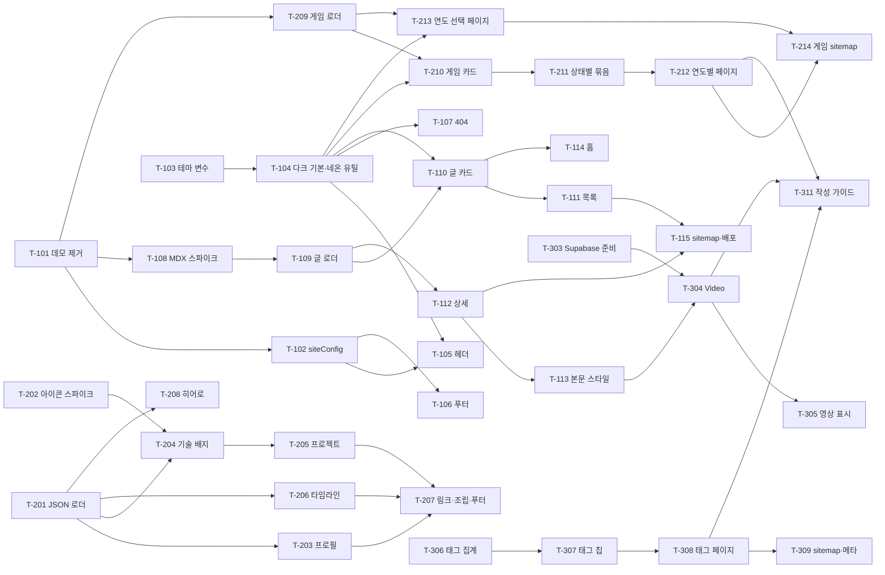

# 로드맵: 게임 개발자 개인 블로그

> 기준 PRD: .claude/docs/PRD.md · 작성일: 2026-11-08

## 1. 개요

- 목표:
  1. 게임 개발자인 운영자를 소개하는 페이지(프로필·기술 스택·프로젝트·경력)를 만든다 (F001~F004).
  2. 글·사진·영상으로 된 개발 기록을 MDX 파일로 쓰고 최신순·태그별로 보여 준다 (F006~F009, F011).
  3. 좋아하고 플레이 중인 게임을 연도별 JSON 기록으로 남기고 연도별 페이지로 보여 준다 (F013, F014).
  4. 시안·마젠타 네온의 게임 개발자 테마를 전 페이지에 적용한다 (F010, F012).
- 성공 지표 (제안):
  - 운영자가 MDX 파일 하나를 커밋·푸시하면 별도 코드 수정 없이 목록·상세·태그 페이지에 반영된다.
  - 운영자가 `content/games/<연도>.json` 하나를 추가하면 코드 수정 없이 연도 카드·연도 탭·연도 페이지가 늘어난다.
  - 모든 페이지가 데스크톱·모바일, 다크·라이트 모드에서 깨지지 않고, 포인트 색 텍스트가 WCAG AA 대비를 만족한다.
- 범위 밖: 로그인·관리자 글쓰기 화면, 댓글·좋아요·구독(RSS), 전체 글 검색·다중 태그 필터·시리즈, 프로젝트 상세 페이지, 문의 폼·이메일 공개, 다국어, 조회수 집계, 코드 블록 복사 버튼·줄 번호·파일 이름, 게임 기록의 상태·플랫폼 필터·게임별 상세 페이지·여러 해 통계·외부 게임 DB(API) 연동 (PRD "MVP 이후 기능")

## 2. 기술 방향

- 아키텍처 요약:
  - `output: "export"` 정적 사이트. 모든 콘텐츠는 저장소 파일이고 **빌드 시점**에 읽는다.
  - 글: `content/posts/<slug>.mdx` (YAML frontmatter: title, date, summary, tags, thumbnail). 사진은 `public/images/posts/<slug>/`.
  - 태그 (결정됨): frontmatter `tags`에는 **영문 slug**(소문자·숫자·하이픈, 예: `shader`)만 쓰고, 화면에 보일 한글 이름은 `content/tags.json`(slug → 표시 이름 대응표)에서 가져온다. 대응표에 없는 태그는 slug를 그대로 표시한다. 주소는 항상 `/blog/tags/<영문 slug>`.
  - "영상 포함" 표시 (결정됨): frontmatter 필드 없이, 로더가 빌드 시 본문에 `<Video` 컴포넌트가 있는지 검사해 `hasVideo`를 계산한다.
  - 소개 데이터: `content/profile.json`, `skills.json`, `projects.json`, `timeline.json`을 `lib/`의 로더가 zod로 검증한 뒤 섹션 컴포넌트에 넘긴다.
  - 게임 기록 (결정됨): `content/games/<연도>.json`(연도 = 파일 이름, 파일 하나 = 연도 페이지 하나), 표지는 `public/images/games/<연도>/`. `lib/games.ts`가 zod로 검증하고 잘못된 데이터는 빌드 실패. 헤더 "게임"(`/games`)은 **연도 선택 페이지**(연도 카드 목록)이고, 연도별 페이지는 `app/games/[year]`(`generateStaticParams` + `dynamicParams = false`, 없는 연도 404). 정적 내보내기라 리디렉션 없이 링크로만 이동한다. 평점은 1~5 정수, 해를 넘긴 게임은 다음 해 파일에 다시 적는다.
  - 코드 블록 (F007): `rehype-pretty-code`가 붙여 주는 언어 정보(`data-language`)를 `mdx-components.tsx`에서 받아 전용 패널 상단에 표시 이름으로 보여 준다. 서버 컴포넌트로만 처리해 클라이언트 JS가 없다.
  - 동적 경로(`app/blog/[slug]`, `app/blog/tags/[tag]`)는 `generateStaticParams` + `export const dynamicParams = false`로 빌드 시 모두 만들고, 없는 경로는 404가 된다 (정적 내보내기는 `dynamicParams: true`를 지원하지 않음 — `static-exports.md` 확인).
  - 영상은 Supabase Storage 공개 버킷 URL을 `<video>`로 재생만 한다 (SDK·API 키 없음).
  - 이미지는 `next/image` 최적화 없이 내보낸다 (기본 loader는 정적 내보내기에서 불가).
  - 데이터 흐름: `content/*` → `lib/posts.ts`, `lib/content.ts` (서버 전용, fs 사용) → `app/*/page.tsx` → `components/sections/*`.
- MDX 방식 (Next.js 16 공식 가이드 `node_modules/next/dist/docs/01-app/02-guides/mdx.md` 확인함):
  - **1순위: `@next/mdx`** (+ `@mdx-js/loader`, `@mdx-js/react`, `@types/mdx`). 공식 가이드의 "Using dynamic imports" 패턴(`await import(\`@/content/posts/${slug}.mdx\`)` + `generateStaticParams` + `dynamicParams = false`)이 이 프로젝트 구조와 그대로 맞는다. 루트에 `mdx-components.tsx`가 **필수**다.
  - 주의 1: `@next/mdx`는 frontmatter를 기본 지원하지 않는다 → 목록용 메타데이터는 `gray-matter`로 원본 파일을 읽고, 렌더링 시 YAML이 본문에 찍히지 않게 `remark-frontmatter`를 쓴다 (또는 MDX 안의 `export const metadata` 방식으로 대체). T-108에서 결정.
  - 주의 2: Turbopack에서는 remark/rehype 플러그인을 **문자열 이름 + 직렬화 가능한 옵션**으로만 지정할 수 있다 (`rehype-pretty-code`의 테마 옵션이 문자열이면 가능할 것으로 보임 — T-301에서 확인).
  - 주의 3: `next.config.ts`에 이미 Turbopack CSS 규칙이 있으므로 `withMDX` 래핑 시 기존 설정이 유지되는지 확인한다.
  - 대안: `@next/mdx`가 막히면 next-mdx-remote(RSC) → Velite 순으로 검토 (React 19 호환 여부는 T-108에서 npm 정보로 확인).
- 추가 라이브러리:
  - `@next/mdx`, `@mdx-js/loader`, `@mdx-js/react`, `@types/mdx` — MDX 렌더링 — Next.js 공식 가이드 방식이라 버전 호환 위험이 가장 낮음
  - `gray-matter` — 목록용 frontmatter 읽기 — 공식 가이드가 언급하는 검증된 도구
  - `remark-frontmatter` (필요 시 `remark-gfm`) — frontmatter 숨김, 표·체크리스트 지원 — remark 공식 생태계
  - `rehype-pretty-code` + `shiki` — 코드 블록 하이라이트(빌드 시) — 클라이언트 JS 없이 다크/라이트 테마 지원
  - `@tailwindcss/typography` — MDX 본문 기본 서식(`prose`) — 공식 가이드 권장, Tailwind v4는 `globals.css`에 `@plugin`으로 등록 (문서 확인 필요)
  - `simple-icons` (또는 `react-icons/si`) — 기술 브랜드 아이콘 — 아이콘 데이터 CC0, T-202에서 확정
  - 기존 재사용: `zod`(콘텐츠 스키마 검증), `next-themes`(기본 다크), `lucide-react`(일반 아이콘), shadcn `Card`/`Badge`/`Avatar`/`Button`/`Separator`
- 기술 검토 필요:
  - 로그인 없이 운영자만 글 작성 — 서버 인증·DB 없음 → MDX 파일을 커밋·푸시하면 GitHub Actions가 빌드·배포 (F011)
  - 영상 호스팅 — 저장소 용량·파일 크기 제한, Pages 대역폭 → Supabase Storage 공개 버킷 URL을 `<video>`로 재생 (F008, T-303에서 무료 플랜 한도 확인)
  - 사진 자동 최적화 — 정적 내보내기에서 기본 이미지 최적화 불가 → 최적화 없이 내보내고 운영자가 WebP·가로 1600px 이하(게임 표지는 가로 600px 이하)로 줄여 저장
  - "게임" 메뉴가 최신 연도로 자동 이동 — 정적 내보내기에서 서버 리디렉션 불가 → `/games`를 연도 선택 페이지로 두고 연도 카드 링크로 이동 (사용자 결정, T-213)
  - 코드 하이라이트 플러그인 — Turbopack은 함수형 옵션을 넘길 수 없음 → 문자열 플러그인 이름·직렬화 가능한 옵션만 사용, 안 되면 빌드를 webpack으로 돌리는 대신 MDX 방식 자체를 재검토 (T-301)
  - ~~한글 태그 URL~~ — (해결됨) 영문 slug만 URL에 쓰고 한글은 표시 이름으로만 사용하기로 결정 (T-306)

## 3. 단계별 계획

### 단계 1: MVP — 네온 테마와 정리된 레이아웃 위에서 MDX 글을 목록·상세로 읽을 수 있게 배포
완료 기준: 스타터킷 데모가 사라지고, 다크 기본 네온 테마의 헤더·푸터·404가 동작하며, 샘플 글 2개가 `/blog` 목록과 `/blog/<slug>` 상세에서 보이고, 홈에 최근 글이 나오는 상태로 `npm run build`가 통과해 배포할 수 있다.

#### 에픽 1.1 스타터킷 정리 (PRD: 메뉴 구조, F010)
- [x] **T-101** 스타터킷 데모 페이지·섹션 제거 · P0 · S · 의존: 없음
  - 완료 조건: `/components` 경로가 빌드 결과에서 사라져 404가 되고, 데모 전용 섹션을 import하는 곳이 없으며 `npm run lint`·`npx tsc --noEmit`·`npm run build`가 통과한다. 쓰지 않게 된 패키지(react-hook-form 등)는 지우지 않고 목록만 남긴다.
  - 위치: app/components/page.tsx, components/sections/component-showcase.tsx, components/sections/example-form.tsx, components/sections/features.tsx, components/sections/cta.tsx (기존 파일 확인 필요 — 재사용할 부분이 있으면 남김)
  - 계획: [plans/T-101.md](plans/T-101.md)
- [x] **T-102** 사이트 설정을 블로그용으로 변경 · P0 · S · 의존: T-101
  - 완료 조건: `siteConfig`의 이름·설명이 블로그 내용으로 바뀌고, `mainNav`가 홈·블로그·게임·소개 4개뿐이며 헤더·모바일 메뉴·sitemap에 같은 4개가 보인다 (`/blog`는 단계 1 T-111, `/games`는 단계 2 T-213에서 만들어짐. 그 전까지 링크 404 허용 — 배포 시 주의는 "5. 위험 요소" 참고).
  - 위치: config/site.ts, app/layout.tsx(메타데이터, 기존 파일 확인 필요)
  - 계획: [plans/T-102.md](plans/T-102.md)

#### 에픽 1.2 게임 개발자 테마 (PRD: F012)
- [x] **T-103** 시안·마젠타 네온 테마 변수 정의 · P0 · M · 의존: 없음
  - 완료 조건: `globals.css`에 다크·라이트 각각 주 포인트(시안)·보조 포인트(마젠타)와 글로우용 변수가 정의되고, 포인트 색 텍스트가 배경 대비 WCAG AA(4.5:1)를 만족함을 대비 측정 결과로 계획 문서에 기록한다. 라이트 모드는 채도·밝기를 낮춘 값을 쓴다.
  - 위치: app/globals.css
  - 계획: [plans/T-103.md](plans/T-103.md)
- [ ] **T-104** 기본 다크 모드와 네온 효과 유틸리티 · P0 · S · 의존: T-103
  - 완료 조건: 저장된 값이 없는 첫 방문에서 다크 모드로 보이고, 토글로 바꾼 값이 새로고침 후에도 유지된다. 글로우·네온 테두리·호버 강조를 Tailwind 유틸리티(`@utility` 등)로 정의해 버튼·카드에 클래스 하나로 붙일 수 있다.
  - 위치: components/providers/theme-provider.tsx 또는 app/layout.tsx (기존 파일 확인 필요), app/globals.css

#### 에픽 1.3 공통 레이아웃 (PRD: F010)
- [ ] **T-105** 헤더·모바일 메뉴 네온 스타일 적용 · P1 · S · 의존: T-102, T-104
  - 완료 조건: 현재 페이지 메뉴가 네온 색으로 강조되고(`/games/2026`처럼 하위 경로에서도 "게임"이 강조됨), 모바일(375px)에서 시트 메뉴가 열려 4개 메뉴와 테마 토글이 동작한다.
  - 위치: components/layout/site-header.tsx, main-nav.tsx, mobile-nav.tsx, components/shared/theme-toggle.tsx (기존 파일 확인 필요)
- [ ] **T-106** 푸터 정리 · P1 · S · 의존: T-102
  - 완료 조건: 푸터에 블로그·게임·소개 링크와 외부 링크 자리가 보인다. 단계 1에서는 외부 링크를 `siteConfig`에 임시로 두고, T-207에서 `profile.json`의 `links`로 바꾼다. 이메일·전화번호는 없다.
  - 위치: components/layout/site-footer.tsx (기존 파일 확인 필요), config/site.ts
- [ ] **T-107** "GAME OVER" 404 페이지 · P0 · S · 의존: T-104
  - 완료 조건: 없는 주소(`/no-such-page`)로 가면 GAME OVER 연출의 안내 문구와 "홈으로"·"블로그 보기" 버튼이 보이고, 각각 `/`·`/blog`로 이동한다. 빌드 결과에 `404.html`이 생긴다.
  - 위치: app/not-found.tsx (규칙: node_modules/next/dist/docs/01-app/03-api-reference/03-file-conventions/not-found.md)

#### 에픽 1.4 MDX 콘텐츠 파이프라인 (PRD: F011, F007)
- [ ] **T-108** MDX 방식 확정 (스파이크) · P0 · M · 의존: T-101
  - 완료 조건: ① 공식 가이드 방식(`@next/mdx` + `mdx-components.tsx` + 동적 import + `generateStaticParams` + `dynamicParams = false`)으로 샘플 글 1개가 `npm run build` 후 `out/blog/<slug>.html`(또는 폴더)로 생성된다. ② frontmatter 처리 방식(gray-matter + `remark-frontmatter` / `export const metadata`)을 하나로 정한다. ③ 설치한 패키지의 peerDependencies가 Next.js 16·React 19와 충돌 없음을 `npm install` 경고 없음으로 확인한다. ④ 막히면 next-mdx-remote(RSC) → Velite 순으로 같은 기준을 검사하고 결과를 계획 문서에 적는다.
  - 위치: next.config.ts, mdx-components.tsx(루트), content/posts/, package.json
- [ ] **T-109** 글 데이터 로더와 샘플 글 · P0 · M · 의존: T-108
  - 완료 조건: `getAllPosts()`가 `content/posts/*.mdx`를 날짜 내림차순으로 돌려주고, `getPostBySlug()`가 한 글을 돌려준다. frontmatter를 zod로 검증해 필수 필드(title, date, summary, tags)가 빠지거나 `tags`에 영문 slug 형식(`^[a-z0-9]+(-[a-z0-9]+)*$`)이 아닌 값(예: `셰이더`, `Shader`)이 있으면 파일 이름이 들어간 메시지와 함께 빌드가 실패한다. 날짜가 다른 샘플 글 2개(이미지 1장 포함, 태그는 영문 slug)를 넣는다.
  - 위치: lib/posts.ts, content/posts/*.mdx, public/images/posts/<slug>/

#### 에픽 1.5 블로그 목록·상세 (PRD: F006, F007)
- [ ] **T-110** 글 카드 컴포넌트 · P0 · S · 의존: T-104, T-109
  - 완료 조건: 카드에 썸네일(없으면 네온 그라데이션 자리 표시), 제목, 요약, 작성일(YYYY-MM-DD), 태그 칩이 보이고 카드 전체를 누르면 글 상세로 간다. 호버 시 네온 테두리가 켜진다. (태그 칩 링크는 T-307에서 연결)
  - 위치: components/shared/post-card.tsx (shadcn Card·Badge 재사용)
- [ ] **T-111** 블로그 목록 페이지 · P0 · S · 의존: T-110
  - 완료 조건: `/blog`에서 샘플 글 2개가 최신순으로 보이고, 글 파일을 모두 빼고 개발 서버에서 보면 "아직 글이 없습니다" 안내가 보인다.
  - 위치: app/blog/page.tsx, components/sections/post-list.tsx, components/shared/page-header.tsx (기존 파일 확인 필요)
- [ ] **T-112** 글 상세 페이지 · P0 · M · 의존: T-109
  - 완료 조건: `/blog/<slug>`에 제목·작성일·태그·대표 이미지·본문과 "목록으로" 버튼이 보이고, 브라우저 탭 제목이 글 제목이다(`generateMetadata`). 없는 slug는 404 페이지가 된다.
  - 위치: app/blog/[slug]/page.tsx, components/sections/post-header.tsx
- [ ] **T-113** 본문 타이포그래피와 MDX 요소 스타일 · P0 · S · 의존: T-112
  - 완료 조건: 본문의 제목 단계·목록·인용·링크·이미지·인라인 코드가 다크·라이트 모두에서 읽기 좋게 보이고(링크는 시안 포인트), 본문 이미지가 화면 폭을 넘지 않는다.
  - 위치: app/globals.css(`@tailwindcss/typography` 등록), mdx-components.tsx

#### 에픽 1.6 홈 최소 버전과 첫 배포 (PRD: F005 일부)
- [ ] **T-114** 홈 페이지를 블로그 홈으로 교체 · P0 · S · 의존: T-110
  - 완료 조건: `/`에 이름·한 줄 소개(단계 1은 `siteConfig` 임시 값)와 최근 글 최대 3개 카드, "전체 글 보기" 버튼이 보이고 버튼이 `/blog`로 이동한다.
  - 위치: app/page.tsx, components/sections/hero.tsx (기존 파일 확인 필요), components/sections/recent-posts.tsx
- [ ] **T-115** sitemap에 글 경로 추가와 첫 배포 점검 (제안) · P1 · S · 의존: T-111, T-112
  - 완료 조건: `out/sitemap.xml`에 `/blog`와 각 글 URL이 들어 있고, `npm run build` 결과물로 `/test` 브라우저 확인을 통과한다. `/games` 페이지(T-213)가 아직 없으면 sitemap에서 `/games`를 임시로 빼거나 단계 1 배포를 미루기로 정하고 계획 문서에 적는다. 푸시는 사용자가 한다.
  - 위치: app/sitemap.ts (기존 파일 확인 필요)

### 단계 2: 소개·플레이 게임 페이지와 홈 완성 — 운영자가 누구이고 무엇을 만들고 즐기는지 보여 주기
완료 기준: `/about`에 프로필·기술 스택·프로젝트·경력 타임라인·외부 링크가 JSON 데이터로 보이고, 홈 히어로와 푸터가 같은 `profile.json`을 쓴다. `/games`에서 연도 카드를 골라 `/games/2026`의 상태별 게임 카드를 볼 수 있고, 게임 데이터가 잘못되면 빌드가 실패한다.

#### 에픽 2.1 소개 데이터와 아이콘 (PRD: F011, F002)
- [ ] **T-201** 소개용 JSON 스키마와 로더 · P0 · M · 의존: 단계 1 완료
  - 완료 조건: `profile.json`, `skills.json`, `projects.json`, `timeline.json`을 zod로 검증하는 로더가 있고, `links`에 `mailto:`·`tel:`이 있거나 `projects[].stack`에 `skills.json`에 없는 이름이 있으면 빌드가 실패한다. 각 파일에 예시 데이터가 들어간다.
  - 위치: lib/content.ts, content/profile.json, content/skills.json, content/projects.json, content/timeline.json
- [ ] **T-202** 기술 브랜드 아이콘 라이브러리 확정 (스파이크) · P0 · S · 의존: 없음
  - 완료 조건: `simple-icons`와 `react-icons/si` 중 하나를 고르고, Unity·Unreal Engine·Godot·C#·C++·Blender·GitHub·YouTube 아이콘이 실제로 있는지, 없는 것(상표 문제로 빠진 로고 등)은 어떻게 대신할지(Lucide 일반 아이콘 또는 텍스트 이니셜)를 표로 기록한다. 라이선스(아이콘 데이터 CC0, 브랜드 상표 지침)와 Lucide 브랜드 아이콘 지원 현황도 함께 적는다.
  - 위치: 계획 문서(plans/T-202.md), package.json

#### 에픽 2.2 소개 페이지 (PRD: F001, F002, F003, F004)
- [ ] **T-203** 프로필 섹션 · P0 · S · 의존: T-201
  - 완료 조건: `/about` 상단에 사진(없으면 이름 이니셜 아바타), 이름, 한 줄 소개, 관심 분야, 지금 공부 중인 것 목록이 보이고, `photo`를 비우면 이니셜 아바타로 바뀐다.
  - 위치: app/about/page.tsx (기존 파일 확인 필요), components/sections/profile-intro.tsx (shadcn Avatar 재사용)
- [ ] **T-204** 기술 스택 배지 · P0 · S · 의존: T-201, T-202
  - 완료 조건: 엔진 / 언어 / 도구 세 분류 제목 아래에 아이콘이 붙은 배지가 보이고, 아이콘이 없는 기술은 대체 표시로 깨지지 않는다.
  - 위치: components/shared/tech-badge.tsx, components/sections/skill-stack.tsx
- [ ] **T-205** 대표 프로젝트 카드 · P0 · S · 의존: T-204
  - 완료 조건: 프로젝트마다 썸네일·제목·요약·사용 기술 배지(T-204 재사용)·외부 링크가 보이고, 링크는 `target="_blank" rel="noopener noreferrer"`로 새 탭에서 열린다. 모바일 1열, 데스크톱 2~3열이다.
  - 위치: components/sections/project-list.tsx
- [ ] **T-206** 경력·학력 세로 타임라인 · P0 · M · 의존: T-201
  - 완료 조건: 기간·이름·소속·설명이 세로 타임라인으로 보이고 work/education이 아이콘이나 색으로 구분된다. 모바일에서 글자가 겹치지 않는다.
  - 위치: components/sections/career-timeline.tsx
- [ ] **T-207** 외부 링크 버튼과 소개 페이지 조립, 푸터 연동 · P0 · S · 의존: T-203, T-205, T-206
  - 완료 조건: 소개 페이지에 외부 링크 버튼(새 탭)과 "블로그 보기" 버튼이 보이고, 푸터의 외부 링크가 `profile.json`의 `links`에서 나오며 T-106의 임시 값이 사라진다.
  - 위치: components/shared/social-links.tsx, components/layout/site-footer.tsx, app/about/page.tsx

#### 에픽 2.3 홈 완성 (PRD: F005)
- [ ] **T-208** 네온 히어로 완성 · P0 · S · 의존: T-201
  - 완료 조건: 홈 히어로의 이름·한 줄 소개·지금 공부 중인 것 요약이 `profile.json`에서 나오고, 네온 글로우 강조와 "소개 보기"(`/about`)·"전체 글 보기"(`/blog`) 버튼이 보인다.
  - 위치: components/sections/hero.tsx, app/page.tsx

#### 에픽 2.4 플레이 게임 기록 (PRD: F013, F014, F011)
- [ ] **T-209** 게임 기록 스키마·로더와 샘플 데이터 · P0 · M · 의존: T-101
  - 완료 조건: `getGameYears()`가 `content/games/*.json` 파일 이름에서 연도 목록을 최신순으로 돌려주고, `getGamesByYear(year)`가 그해 게임을 돌려준다. zod로 검증해 다음 경우 **파일 이름이 들어간 메시지와 함께 빌드가 실패**한다: 필수 필드(slug, title, platforms, status) 누락, `status`가 playing/cleared/dropped/wishlist 외의 값, `rating`이 1~5 정수가 아님(예: 0, 6, 4.5, "5"), 날짜가 YYYY-MM-DD가 아님, `clearedAt`이 있는데 `status`가 cleared가 아님, 같은 파일 안 slug 중복, 파일 이름이 네 자리 연도가 아님. `content/games/2026.json`에 네 가지 상태가 모두 들어간 샘플 게임(표지 있는 것·없는 것 각 1개 이상)을 넣는다. 추가 라이브러리 없이 기존 `zod`를 쓴다.
  - 위치: lib/games.ts, content/games/2026.json, public/images/games/2026/
- [ ] **T-210** 게임 카드 컴포넌트 · P0 · M · 의존: T-104, T-209
  - 완료 조건: 카드에 세로형 표지(없으면 제목 이니셜 네온 자리표시), 제목, 플랫폼 배지(여러 개), 상태 배지(한글: 플레이 중/클리어/중단/하고 싶은 게임), 평점(Lucide 별 5개 중 n개 채움, 스크린 리더용 "5점 만점에 n점" 텍스트), 한 줄 소감, 플레이 시간(시간), 시작일, 클리어일이 보인다. 값이 없는 항목은 빈 자리 없이 숨겨진다(샘플의 wishlist 카드에서 평점·날짜가 보이지 않음).
  - 위치: components/shared/game-card.tsx, components/shared/star-rating.tsx (shadcn Card·Badge, lucide-react 재사용)
- [ ] **T-211** 상태별 게임 묶음 섹션 · P0 · S · 의존: T-210
  - 완료 조건: 게임이 플레이 중 → 클리어 → 중단 → 하고 싶은 게임 순서의 묶음 제목 아래 보이고, 묶음 안은 시작일 최신순(시작일 없으면 제목순)이다. 상단에 "플레이 중 n · 클리어 n · 중단 n · 하고 싶은 게임 n" 요약이 보이고, 게임이 없는 묶음은 제목째 숨긴다. 그해 게임이 0개면 "아직 기록한 게임이 없습니다"가 보인다. 모바일 2열, 데스크톱 4~5열.
  - 위치: components/sections/game-list.tsx (정렬·집계는 lib/games.ts)
- [ ] **T-212** 연도별 플레이 게임 페이지 · P0 · M · 의존: T-211
  - 완료 조건: `/games/2026`에 "2026 플레이 게임" 제목, 연도 전환 탭(데이터가 있는 연도만·최신 연도가 앞·현재 연도 네온 강조·연도가 하나여도 표시), T-211 섹션, 페이지 아래 출처 문구 "표지 이미지 저작권은 각 게임사에 있습니다"가 보인다. `generateStaticParams` + `dynamicParams = false`로 연도 페이지가 모두 빌드되어 `out/games/2026`(파일 또는 폴더)이 생기고, `/games/2020`처럼 파일이 없는 연도는 404가 된다. 브라우저 탭 제목이 연도를 포함한다(`generateMetadata`). `content/games/2025.json`을 임시로 추가해 빌드하면 탭과 페이지가 하나 늘어남을 확인한다.
  - 위치: app/games/[year]/page.tsx, components/shared/year-tabs.tsx, components/sections/game-cover-credit.tsx (규칙: node_modules/next/dist/docs/01-app/03-api-reference/04-functions/generate-static-params.md — `dynamicParams = false` 시 미생성 경로 404 확인함)
- [ ] **T-213** 연도 선택 페이지 (`/games`) · P0 · S · 의존: T-209, T-104
  - 완료 조건: 헤더 "게임"을 누르면 `/games`에 연도 카드 목록(최신 연도가 앞)이 보이고, 각 카드에 연도와 상태별 게임 수가 보이며 누르면 `/games/<연도>`로 이동한다. 링크는 `next/link`로 만들고 리디렉션은 쓰지 않는다. 게임 파일이 하나도 없으면 안내 문구가 보인다.
  - 위치: app/games/page.tsx, components/sections/game-year-list.tsx
- [ ] **T-214** 게임 연도 페이지 sitemap 추가 (제안) · P1 · S · 의존: T-212, T-213
  - 완료 조건: `out/sitemap.xml`에 `/games`와 모든 `/games/<연도>` URL이 들어 있다. T-115에서 `/games`를 sitemap에서 임시로 뺐다면 이 작업에서 되돌린다.
  - 위치: app/sitemap.ts

### 단계 3: 블로그 확장 — 코드 하이라이트, 영상, 이전/다음, 태그
완료 기준: 글 상세에서 코드 블록이 하이라이트되고 Supabase 영상이 재생되며 이전/다음 글로 이동할 수 있고, 태그 칩을 누르면 태그별 글 목록 페이지로 간다.

#### 에픽 3.1 글 상세 확장 (PRD: F007)
- [ ] **T-301** 코드 블록 하이라이트와 전용 패널 · P0 · L · 의존: 단계 1 완료
  - 완료 조건: ① C#·C++·HLSL·TypeScript 코드 블록이 빌드 시 하이라이트되고 다크·라이트 테마 색이 각각 따라 바뀐다 (shiki 언어 목록에서 `csharp`·`cpp`·`hlsl` 지원을 확인해 계획 문서에 적음). ② 코드 블록이 본문과 다른 배경·테두리(F012 테마 변수)의 전용 패널에 보이고, 패널 상단 바에 언어 이름이 표시 이름으로 보인다(`csharp`→C#, `cpp`→C++, `hlsl`→HLSL 등, 변환표에 없으면 원래 이름). ③ 언어를 적지 않은 블록은 상단 바의 언어 이름 없이 패널만 보인다. ④ 긴 줄은 패널 안에서 가로 스크롤되고 페이지 폭을 넘지 않는다. ⑤ 복사 버튼·줄 번호·파일 이름은 없고 클라이언트 JS를 추가하지 않는다. ⑥ Turbopack에서 플러그인을 문자열 이름과 직렬화 가능한 옵션으로 지정해 `npm run build`가 통과한다.
  - 위치: next.config.ts, mdx-components.tsx(`pre`/`figure` 대응), components/shared/code-block.tsx, app/globals.css, package.json
- [ ] **T-302** 이전/다음 글 링크 · P0 · S · 의존: 단계 1 완료
  - 완료 조건: 글 상세 하단에 날짜순 이전·다음 글 제목 링크가 보이고, 가장 오래된/최신 글에서는 해당 쪽 링크가 나오지 않는다.
  - 위치: lib/posts.ts, components/sections/post-nav.tsx

#### 에픽 3.2 영상 (PRD: F008)
- [ ] **T-303** Supabase Storage 준비와 무료 플랜 한도 확인 · P0 · S · 의존: 없음 (운영자 작업 포함)
  - 완료 조건: 공개 버킷에 압축한 테스트 영상(H.264 MP4, 1080p 이하)을 올리고, 공개 URL이 브라우저에서 재생되며 구간 이동(Range 요청)이 된다. 현재 무료 플랜의 저장 용량·전송량(egress) 한도와 영상 1개당 권장 크기를 계획 문서에 기록한다. API 키·서비스 키는 어디에도 적지 않는다.
  - 위치: 계획 문서(plans/T-303.md) — 코드 변경 없음
- [ ] **T-304** MDX `Video` 컴포넌트 · P0 · S · 의존: T-113, T-303
  - 완료 조건: MDX에서 `<Video src="..." poster="..." />`를 쓰면 기본 컨트롤(재생·일시정지·전체 화면)이 있는 플레이어가 본문 폭에 맞게 보이고, 모바일에서 인라인 재생(`playsInline`)되며, `preload="metadata"`로 페이지 로드 시 영상 전체를 받지 않는다. poster가 없어도 동작한다.
  - 위치: components/shared/video.tsx, mdx-components.tsx
- [ ] **T-305** 목록 카드에 "영상 포함" 표시 · P1 · S · 의존: T-304, T-110
  - 완료 조건: 로더가 빌드 시 MDX 원문에 `<Video` 컴포넌트가 있는지 검사해 글마다 `hasVideo`를 계산하고(frontmatter에 `hasVideo` 필드는 추가하지 않음), 본문에 `<Video`가 있는 샘플 글의 카드에만 영상 아이콘 표시가 보인다. 코드 블록(```` ``` ````) 안에 예시로 적힌 `<Video`는 영상으로 세지 않는다.
  - 위치: lib/posts.ts, components/shared/post-card.tsx

#### 에픽 3.3 태그 (PRD: F009)
- [ ] **T-306** 태그 집계와 한글 표시 이름 대응표 · P0 · S · 의존: 단계 1 완료
  - 완료 조건: `getAllTags()`가 태그마다 `{ slug, label, count }`를 돌려준다. `label`은 `content/tags.json`(예: `{ "shader": "셰이더" }`, zod 검증)에서 가져오고 대응표에 없으면 slug를 그대로 쓴다. 샘플 글에 `shader` 태그를 붙이고 대응표에 `셰이더`를 넣어 빌드하면 `out/blog/tags/shader`(파일 또는 폴더)가 생기고 화면에는 "셰이더"로 보인다. 대응표 키가 slug 형식이 아니면 빌드가 실패한다.
  - 위치: lib/posts.ts, content/tags.json
- [ ] **T-307** 태그 칩 목록과 태그 링크 연결 · P0 · S · 의존: T-306
  - 완료 조건: `/blog` 상단에 전체 태그 칩(한글 표시 이름 + 글 수)이 보이고, 목록 카드와 글 상세의 태그 칩도 표시 이름으로 보이며, 누르면 `/blog/tags/<영문 slug>`로 간다. 현재 태그를 네온으로 강조하는 옵션이 있다.
  - 위치: components/shared/tag-list.tsx, components/shared/post-card.tsx, components/sections/post-header.tsx, app/blog/page.tsx
- [ ] **T-308** 태그별 글 목록 페이지 · P0 · M · 의존: T-307
  - 완료 조건: `/blog/tags/<영문 slug>`에 태그 표시 이름(한글 가능)·글 수·해당 글 최신순 카드·전체 태그 칩(현재 태그 강조)·"전체 글" 버튼이 보인다. `generateStaticParams` + `dynamicParams = false`로 모든 태그 페이지가 빌드되고 없는 태그는 404가 된다.
  - 위치: app/blog/tags/[tag]/page.tsx

#### 에픽 3.4 마무리 (제안)
- [ ] **T-309** 태그 페이지 sitemap 추가와 페이지별 메타데이터·OG 정보 (제안) · P2 · S · 의존: T-308
  - 완료 조건: `out/sitemap.xml`에 태그 페이지가 들어 있고, 소개·블로그·글 상세 페이지에 각각 다른 title·description이 있다.
  - 위치: app/sitemap.ts, 각 app/*/page.tsx
- [ ] **T-310** basePath 대응 이미지 경로 처리 (제안) · P2 · S · 의존: 단계 1 완료
  - 완료 조건: `PAGES_BASE_PATH`를 임시로 지정해 빌드했을 때 썸네일·본문 이미지·프로필 사진이 깨지지 않는다. (현재 basePath가 비어 있으므로 나중으로 미뤄도 됨)
  - 위치: lib/ 경로 유틸 또는 next.config.ts, mdx-components.tsx
- [ ] **T-311** 운영자용 글 작성 가이드 (제안) · P2 · S · 의존: T-304, T-308, T-212
  - 완료 조건: 새 글 파일 만들기, frontmatter 예시(태그는 영문 slug), 새 태그의 한글 이름을 `content/tags.json`에 추가하기, 이미지 크기 줄이기(WebP·가로 1600px), Supabase에 영상 올리고 `<Video>` 넣기 절차가 한 문서에 정리된다. 게임 기록 추가 절차(연도 파일 만들기, 필드 예시, 해를 넘긴 게임은 다음 해 파일에 다시 적기, 표지는 공식 스토어·보도자료 이미지를 가로 600px 이하로 줄여 `public/images/games/<연도>/`에 저장)도 포함한다.
  - 위치: docs/writing-posts.md

## 4. 의존성 요약



- 단계 2의 T-201과 단계 3의 T-301·T-302·T-306은 단계 1 완료 후 시작한다.
- 게임 에픽(T-209~T-214)은 소개 에픽과 독립이라 T-101·T-104가 끝나면 단계 1과 나란히 진행할 수도 있다 (`/games` 링크 404 기간을 줄이려면 앞당기는 것도 방법).
- T-202(아이콘)와 T-303(Supabase 준비)은 의존이 없어 언제든 먼저 할 수 있다.
- 바로 착수 가능: T-101, T-103 (서로 독립).

## 5. 위험 요소

| 위험 | 영향 | 대응 |
|------|------|------|
| `@next/mdx`가 Turbopack·`output: "export"` 조합에서 동적 import로 빌드되지 않음 | 글 상세 전체가 막힘 | T-108을 단계 1 초반 스파이크로 두고, 실패 시 next-mdx-remote(RSC) → Velite 순으로 전환 |
| Turbopack에서 함수형 옵션이 필요한 rehype 플러그인 사용 불가 | 코드 하이라이트 품질 저하 | 문자열 이름·직렬화 가능한 옵션만 쓰는 구성 확인(T-301), 안 되면 하이라이트 방식 재검토 |
| 글이 0개일 때 `generateStaticParams`가 빈 배열을 돌려 정적 내보내기 빌드가 실패할 수 있음 | 배포 실패 | 샘플 글을 최소 1개 유지(T-109), 빈 경우 동작을 T-108에서 확인 |
| ~~한글 태그의 정적 파일 이름·URL 인코딩 문제~~ (해결됨) | — | URL은 영문 slug만 쓰기로 결정. T-109에서 slug 형식 검증, T-306에서 한글 표시 이름 대응표 |
| 운영자가 태그 대응표(`content/tags.json`)에 한글 이름을 빠뜨림 | 칩에 영문 slug가 그대로 보임 (기능 문제는 없음) | slug를 그대로 표시하는 폴백, T-311 작성 가이드에 대응표 갱신 절차 포함 |
| Supabase 무료 플랜 저장·전송량 초과, 장기간 미사용 시 프로젝트 일시 중지 가능성 | 영상이 재생되지 않음 | T-303에서 한도 확인·기록, 영상 압축 규칙, 글에 poster 이미지 두기 |
| 기술 브랜드 아이콘 일부(예: Microsoft 계열 로고)가 아이콘 라이브러리에 없음 | 배지 일부가 비어 보임 | T-202에서 존재 여부 표 작성, 대체 표시 규칙 적용 |
| 네온 색의 라이트 모드 대비 부족 | 가독성·접근성 저하 | T-103에서 WCAG AA 대비 측정 후 값 결정 |
| `PAGES_BASE_PATH`를 나중에 쓰면 `public/` 이미지 경로 깨짐 | 이미지 누락 | T-310에서 대응 (basePath를 쓰기 전까지는 영향 없음, 게임 표지 포함) |
| T-102로 `mainNav`가 4개가 되어 sitemap·헤더에 아직 없는 `/blog`(T-111 전)·`/games`(T-213 전)가 들어감 | 배포하면 검색엔진·방문자가 404를 만남 | 해당 페이지가 생기기 전에는 배포하지 않거나, sitemap에서 임시로 제외 (T-115에서 결정, T-214에서 되돌림) |
| 게임 표지는 저작권이 있는 이미지 | 저작권 문제 제기 가능성 | 공식 스토어·보도자료 이미지만 가로 600px 이하로 줄여 쓰고, 연도 페이지 아래에 "표지 이미지 저작권은 각 게임사에 있습니다" 출처 문구 표시 (T-212). 문제가 되면 이니셜 자리표시로 대체 |
| 게임 JSON 수기 입력 실수(상태 오타, 평점 4.5 등) | 화면 깨짐·잘못된 표시 | T-209의 zod 검증으로 빌드 실패시키고 메시지에 파일 이름 표시 |
| shiki가 HLSL 등 일부 언어를 지원하지 않음 | 해당 블록 하이라이트 없음 | T-301에서 언어 목록 확인, 미지원 언어는 하이라이트 없이 패널·언어 이름만 표시 |

## 6. 미결 사항

- frontmatter 처리를 YAML(gray-matter + remark-frontmatter)로 할지 MDX `export const metadata`로 할지 — 결정 전까지 가정: PRD 데이터 모델대로 YAML frontmatter (T-108에서 확정)
- 기술 브랜드 아이콘 라이브러리 — 결정 전까지 가정: `simple-icons` 계열, 없는 로고는 텍스트 이니셜 배지 (T-202에서 확정)
- Supabase 무료 플랜 한도 — 결정 전까지 가정: 영상은 H.264 MP4 1080p 이하로 압축해 올림 (T-303에서 확인)
- 단계 1에서 이름·한 줄 소개·외부 링크의 임시 위치 — 결정 전까지 가정: `config/site.ts`에 두고 단계 2(T-207, T-208)에서 `profile.json`으로 옮김
- 스타터킷 데모 제거 후 쓰지 않는 패키지(react-hook-form 등) 삭제 여부 — 결정 전까지 가정: 남겨 둠 (문의 폼이 MVP 이후 범위에 있음)
- 단계 1 배포 시 아직 없는 `/games` 처리 — 결정 전까지 가정: sitemap에서 임시 제외하고 헤더 링크 404는 허용 (T-115에서 확정, 또는 게임 에픽을 앞당김)
- `wishlist`(하고 싶은 게임)에 평점이 들어 있으면 빌드 실패로 할지 — 결정 전까지 가정: 경고 없이 허용하되 카드에서는 숨김 (T-209에서 확정)
- 코드 블록 언어 표시 이름 변환표 범위 — 결정 전까지 가정: C#, C++, HLSL, GLSL, TypeScript, JavaScript, JSON, Shell 정도 (T-301에서 확정)
- PRD 문구 불일치 — PRD의 사용자 여정·F014는 헤더 "게임"이 "최신 연도를 보여 줌"으로 되어 있으나 사용자 결정은 연도 선택 페이지. ROADMAP은 사용자 결정을 따르며 PRD 문구 수정 필요

### 결정됨

- 태그 URL 규칙 (2026-11-08) — URL은 영문 slug만 사용. frontmatter `tags`에 영문 slug를 쓰고, 한글 표시 이름은 `content/tags.json` 대응표로 지정 (예: `shader` → "셰이더", `/blog/tags/shader`). 반영: T-109, T-306, T-307, T-308
- "영상 포함" 표시 판별 방식 (2026-11-08) — 빌드 시 본문에 `<Video` 컴포넌트가 있는지 자동 감지. frontmatter `hasVideo` 필드는 추가하지 않음. 반영: T-305
- 게임 페이지 구조 (2026-11-08) — 헤더 "게임"(`/games`)은 연도 카드 목록인 연도 선택 페이지, 연도별 페이지는 `/games/<연도>`(`generateStaticParams`), 없는 연도는 404. 반영: T-212, T-213
- 게임 표지 이미지 (2026-11-08) — 공식 스토어·보도자료 이미지를 가로 600px 이하로 줄여 쓰고, 페이지 아래에 "표지 이미지 저작권은 각 게임사에 있음" 출처 문구 표시. 반영: T-212, T-311
- 게임 기록 규칙 (2026-11-08) — 평점 1~5 정수, 연도별 파일, 해를 넘긴 게임은 다음 해 파일에 다시 적음 (PRD 가정 그대로). 반영: T-209
- 코드 블록 표시 (2026-11-08) — 전용 배경 패널 + 상단 언어 이름, 복사 버튼·줄 번호·파일 이름 없음. 반영: T-301
- 헤더 메뉴 (2026-11-08) — 홈 / 블로그 / 게임 / 소개 4개. 반영: T-102, T-105, T-106

## 7. 공통 완료 기준 (Definition of Done)

- `npm run lint`, `npx tsc --noEmit`, `npm run build` 통과
- 코드 리뷰(`code-reviewer`) 반영
- `/test`로 브라우저 확인 (데스크톱·모바일, 라이트·다크 모드)
- 새 페이지는 `config/site.ts`의 `mainNav`에 등록 (메뉴에 없는 글 상세·태그·404 페이지는 제외)
- 커밋은 `/commit` 또는 `/commit-test`(privacy-guard 검사 포함)로 하고, 푸시는 사용자가 GitHub Desktop에서
